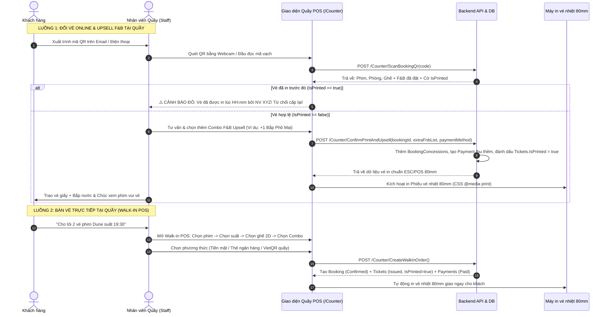
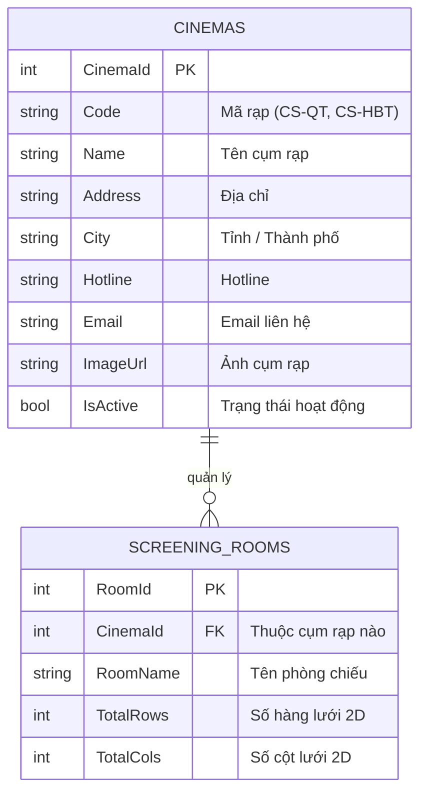
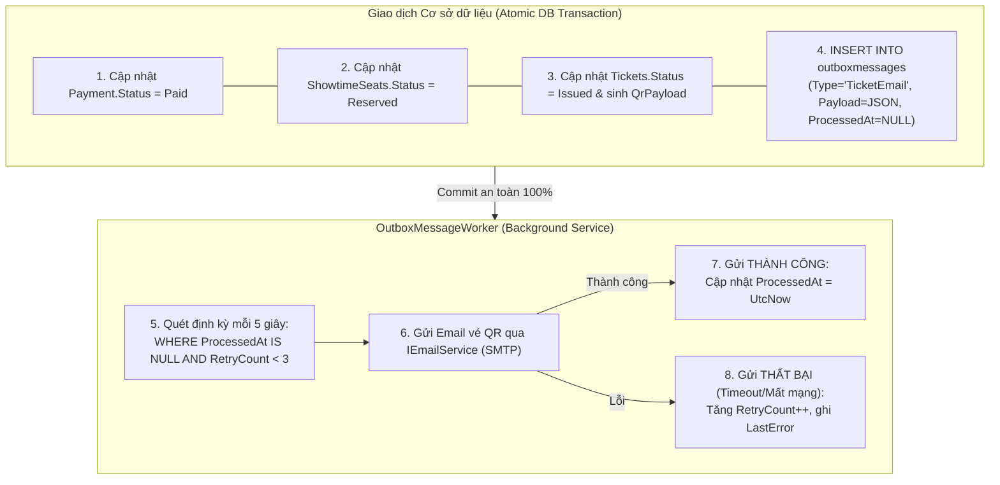
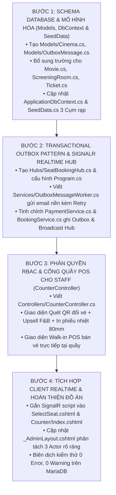

# BÁO CÁO ĐỐI CHIẾU & ĐÁNH GIÁ KIẾN TRÚC HỆ THỐNG CINEMANAGEMENT
### Dưới góc nhìn: Giám khảo chấm Đồ án tốt nghiệp & Kiến trúc sư phần mềm (Enterprise Software Architect)

---

> [!IMPORTANT]
> **Tình trạng kiểm tra:** Đã rà soát 100% mã nguồn hiện tại của dự án [**`CineManagement`**](file:///c:/Users/admin/Documents/GitHub/Cinema-Managment/CineManagement), cấu hình database MariaDB/MySQL (`cinema_db`), các Controller, Service, ViewModel và View.  
> **Nguyên tắc:** **BÁO CÁO PHÂN TÍCH - CHƯA VIẾT CODE Ở BƯỚC NÀY**. Báo cáo chỉ rõ hiện trạng, các lỗ hổng dưới góc độ học thuật & thực tế doanh nghiệp rạp chiếu phim, cùng kế hoạch nâng cấp chi tiết từng file.

---

## I. BẢNG MA TRẬN ĐỐI CHIẾU 7 YÊU CẦU CỦA GVHD VS HIỆN TRẠNG

| STT | Hạng mục Yêu cầu của GVHD | Hiện trạng trong Codebase CineManagement | Đánh giá của Giám khảo / Kiến trúc sư | Mức độ Đáp ứng |
|:---:|:---|:---|:---|:---:|
| **1** | **Nghiệp vụ Quét QR tại Quầy (Counter QR Scan, Upsell F&B & In vé nhiệt 80mm)** | - [`ScanTicket.cshtml`](file:///c:/Users/admin/Documents/GitHub/Cinema-Managment/CineManagement/Views/Admin/ScanTicket.cshtml) và [`AdminController.ProcessTicketScan`](file:///c:/Users/admin/Documents/GitHub/Cinema-Managment/CineManagement/Controllers/AdminController.cs) hiện tại thiết kế theo mô hình **"Soát vé ở cửa phòng chiếu (Door Check-in)"**.<br/>- Đã có tính năng đọc mã QR bằng camera (`html5-qrcode`) và kiểm tra tính hợp lệ của đơn hàng.<br/>- **CHƯA CÓ** tính năng Upsell: cho phép nhân viên chọn thêm món F&B ngay trên màn hình quét QR và tính tiền thu thêm tại quầy.<br/>- **CHƯA CÓ** chức năng in vé nhiệt vật lý khổ 80mm (Thermal Ticket) với CSS `@media print`.<br/>- Chưa có các trường `IsPrinted`, `PrintedAt`, `PrintedByUserId` trong [`Ticket`](file:///c:/Users/admin/Documents/GitHub/Cinema-Managment/CineManagement/Models/Ticket.cs) để chống in/quét lại mã QR 2 lần.<br/>- **CHƯA CÓ** Luồng 2 (Walk-in POS cho khách vãng lai mua vé + F&B trực tiếp tại quầy). | ❌ **Sai lệch nghiệp vụ rạp thực tế.** Các cụm rạp lớn tại Việt Nam (CGV, Lotte, Beta, CineStar) không dùng nhân viên đứng quét QR vào cửa phòng chiếu. Khách đặt online bắt buộc ra quầy vé quét mã QR đổi lấy vé giấy (Thermal Ticket 80mm) và lấy bắp nước. Quầy vé là cơ hội vàng để **Upsell F&B** (chiếm 40-50% lợi nhuận rạp). Việc thiếu Luồng POS tại quầy làm đồ án thiếu một nửa nghiệp vụ bán vé. | **20%**<br/>*(Đã có camera scanner & QR parsing)* |
| **2** | **Phạm vi "Hãng rạp chiếu phim" (Cinema Brand / Chain)** | - Chưa có bảng `Cinemas` (Cụm rạp / Chi nhánh).<br/>- Bảng [`ScreeningRoom`](file:///c:/Users/admin/Documents/GitHub/Cinema-Managment/CineManagement/Models/ScreeningRoom.cs) đứng độc lập, không có FK `CinemaId`.<br/>- Dữ liệu 3 phòng chiếu ([`SeedData.cs`](file:///c:/Users/admin/Documents/GitHub/Cinema-Managment/CineManagement/Data/SeedData.cs)) không thuộc cụm rạp nào.<br/>- Giao diện đặt vé online và quản trị thiếu bộ lọc theo Cụm rạp. | ❌ **Thiếu tính thực tế doanh nghiệp.** Tên đồ án là "Quản lý rạp chiếu phim" của một hãng nhưng database chỉ phản ánh 1 địa điểm phòng chiếu vô danh, không mô hình hóa được mạng lưới chi nhánh (ví dụ: *CineStar Quốc Thanh - Q.1, CineStar Hai Bà Trưng - Q.3, CineStar Bình Dương*). | **0%**<br/>*(Chưa có Entity & Table)* |
| **3** | **Phân định rõ 3 Actor (Customer - Admin - Staff)** | - Có 3 role trong Identity: `Customer`, `Admin`, `Staff`.<br/>- Tuy nhiên phân quyền đang bị **trộn lẫn**: [`AdminController`](file:///c:/Users/admin/Documents/GitHub/Cinema-Managment/CineManagement/Controllers/AdminController.cs) dùng `[Authorize(Roles = "Admin,Staff")]`, cho phép Staff vào cả Dashboard, Báo cáo doanh thu ([`Reports.cshtml`](file:///c:/Users/admin/Documents/GitHub/Cinema-Managment/CineManagement/Views/Admin/Reports.cshtml)), Cấu hình phòng chiếu.<br/>- Menu [`_AdminLayout.cshtml`](file:///c:/Users/admin/Documents/GitHub/Cinema-Managment/CineManagement/Views/Shared/_AdminLayout.cshtml) hiển thị chung cho cả Staff và Admin. | ⚠️ **Lỗi phân quyền (RBAC Violation).** Nhân viên quầy bán vé không được phép xem doanh thu, lợi nhuận nhạy cảm của rạp. Nhân viên quầy cần một giao diện **POS chuyên dụng** tối ưu cho thao tác nhanh (Đổi vé QR - Upsell - Bán vé nhanh - In vé nhiệt). | **40%**<br/>*(Có Role nhưng chưa phân tách Portal)* |
| **4** | **Transactional Outbox Pattern ("Out of box pattern")** | - [`PaymentService.cs`](file:///c:/Users/admin/Documents/GitHub/Cinema-Managment/CineManagement/Services/PaymentService.cs) dùng `Task.Run` chạy ngầm `_emailService.SendTicketEmailAsync()`.<br/>- Chưa có bảng `OutboxMessages`.<br/>- Chưa có Background Worker xử lý Outbox kèm Retry. | ❌ **Lỗ hổng kiến trúc lớn (Dual-Write Anti-pattern).** `Task.Run` không đảm bảo tính toàn vẹn: nếu server restart hoặc crash ngay sau khi commit thanh toán, tác vụ trong RAM bị mất và khách **vĩnh viễn không nhận được email mã QR vé**. Không có cơ chế lưu trữ nguyên tử và không có Retry khi SMTP gặp sự cố. | **0%**<br/>*(Đang dùng Task.Run fire-and-forget)* |
| **5** | **Xử lý Thời gian thực khi đặt ghế (Real-time Seat Map)** | - Chưa cấu hình SignalR trong [`Program.cs`](file:///c:/Users/admin/Documents/GitHub/Cinema-Managment/CineManagement/Program.cs).<br/>- Chưa có SignalR Hub.<br/>- [`SelectSeat.cshtml`](file:///c:/Users/admin/Documents/GitHub/Cinema-Managment/CineManagement/Views/Booking/SelectSeat.cshtml) hoạt động theo HTTP POST tĩnh. Khách B không thấy ghế khách A đang giữ đổi màu cho đến khi tải lại trang hoặc click vào ghế rồi nhận thông báo lỗi đụng độ. | ❌ **Thiếu trải nghiệm thực tế.** Một hệ thống đặt vé hiện đại bắt buộc phải có WebSockets/SignalR: khi Khách A (hoặc Nhân viên tại quầy) vừa bấm chọn giữ ghế, màn hình của Khách B đang mở cùng suất chiếu phải tự động chuyển ghế sang màu cam (Đang giữ chỗ) ngay lập tức. | **0%**<br/>*(Chưa tích hợp SignalR)* |
| **6** | **Chuẩn hóa Thông tin Phim (`Movies`) & Ghế (`Seats`)** | - [`Movie.cs`](file:///c:/Users/admin/Documents/GitHub/Cinema-Managment/CineManagement/Models/Movie.cs) đã có: `Title`, `Director`, `Actors`, `Duration`, `AgeRating`, `Language`, `ReleaseDate`, `Rating`.<br/>- **CÒN THIẾU:** `Country` (Quốc gia sản xuất), `Format` (Định dạng chiếu: 2D, 3D, IMAX), `SubtitleType` (Phụ đề/Lồng tiếng).<br/>- [`Ticket.cs`](file:///c:/Users/admin/Documents/GitHub/Cinema-Managment/CineManagement/Models/Ticket.cs) thiếu các trường trạng thái in vé vật lý. | ⚠️ **Thiếu 2-3 trường chuẩn nghiệp vụ điện ảnh.** Cần bổ sung để hiển thị đầy đủ trên vé in nhiệt và bộ lọc phim. | **70%**<br/>*(Đã có phần lớn trường chuẩn)* |
| **7** | **Bỏ SQLite fallback & Phi chức năng thực tế + Tài liệu** | - Đã loại bỏ 100% SQLite, chỉ chạy Pure MariaDB/MySQL 10.11 (`cinema_db`).<br/>- Đã xử lý Concurrency an toàn qua trường `Version` (`[ConcurrencyCheck]`) trên `ShowtimeSeats`.<br/>- Tài liệu đồ án cũ chưa cập nhật kiến trúc Outbox, SignalR, bảng `Cinemas` và luồng POS Quầy. | ⚠️ **Cần đồng bộ tài liệu.** Mã nguồn và database sau khi hoàn thiện cần được cập nhật nhất quán vào tài liệu đồ án và sơ đồ ERD/BFD/Architecture. | **60%**<br/>*(DB chuẩn nhưng tài liệu chưa sync)* |

---

## II. PHÂN TÍCH KIẾN TRÚC CHUYÊN SÂU 5 BÀI TOÁN CỐT LÕI

### 1. Chuẩn Hóa Nghiệp Vụ Quầy Vé POS (Counter POS, Upsell F&B & In Vé Nhiệt 80mm)

#### Bản chất nghiệp vụ thực tế
Rạp chiếu phim không phải là cổng xe buýt hay nhà ga để khách quét QR vào thẳng phòng chiếu. Quầy vé (`Box Office / Counter POS`) giữ vai trò:
1. **Kiểm soát & Định danh:** Khách đưa mã QR từ email cho nhân viên quầy quét -> Xác minh đơn hàng -> In vé giấy nhiệt (Thermal Ticket 80mm) có mã vạch / số hiệu ghế.
2. **Upsell F&B (Tăng doanh thu trung bình trên mỗi khách - ARPU):** Nhân viên quầy mời khách mua thêm Combo bắp rang bơ, nước ngọt, snack với giá ưu đãi. Khách thanh toán bổ sung tiền mặt hoặc quẹt thẻ/quét VietQR ngay tại quầy.
3. **Phòng chống gian lận (Anti-fraud):** Sau khi in vé nhiệt, hệ thống đánh dấu `IsPrinted = true`, `PrintedAt = DateTime.UtcNow`, `PrintedByUserId = staffId`. Nếu khách dùng lại ảnh QR cũ hoặc gửi cho người khác quét lần 2, hệ thống lập tức báo lỗi và từ chối in lại vé.
4. **Bán vé trực tiếp cho khách vãng lai (Walk-in POS):** Khách đến rạp không đặt trước -> Nhân viên chọn phim, suất chiếu, ghế trên lưới 2D trực quan, thêm bắp nước -> Thu tiền -> In vé nhiệt ngay trong vòng 30 giây.



---

### 2. Mô Hình Chuỗi Cụm Rạp (`Cinemas`) & Quan Hệ 1-N

Bổ sung bảng `cinemas` để hệ thống thực sự phản ánh một chuỗi rạp chiếu phim (Cinema Chain):



- **Tác động nghiệp vụ:**
  - **Khách hàng online:** Chọn xem lịch chiếu theo cụm rạp gần nhất (CineStar Quốc Thanh - Q.1, CineStar Hai Bà Trưng - Q.3, CineStar Bình Dương).
  - **Quản lý rạp (Admin):** Xem doanh thu và quản lý phòng chiếu phân theo từng cụm rạp.
  - **Nhân viên quầy (Staff):** Đăng nhập vào ca làm việc tại cụm rạp được phân công.

---

### 3. Phân Quyền Chuẩn 3 Actor Độc Lập (RBAC)

Tách biệt hoàn toàn không gian làm việc của 3 đối tượng người dùng:

```
┌────────────────────────────────────────────────────────────────────────┐
│                        3 ACTOR CỦA HỆ THỐNG                            │
├──────────────────┬──────────────────────┬──────────────────────────────┤
│ 1. KHÁCH HÀNG    │ 2. NHÂN VIÊN QUẦY    │ 3. QUẢN LÝ RẠP               │
│    (Customer)    │    (Staff)           │    (Admin)                   │
├──────────────────┼──────────────────────┼──────────────────────────────┤
│ • Xem phim       │ • Cổng POS Quầy vé   │ • Toàn quyền hệ thống        │
│ • Chọn rạp/suất  │   (/Counter)         │ • Báo cáo doanh thu chi tiết │
│ • Đặt ghế 2D     │ • Quét QR đổi vé     │ • Quản lý Cụm rạp (Cinemas)  │
│ • Thanh toán     │ • Upsell bắp nước    │ • Quản lý Phòng & Lưới ghế 2D│
│   VietQR online  │ • In vé nhiệt 80mm   │ • Quản lý Phim, Suất chiếu   │
│ • Nhận email vé  │ • Bán vé Walk-in     │ • Quản lý Danh mục F&B       │
│ • Lịch sử vé     │ • Đơn trong ca trực  │ • Quản lý Nhân sự & Phân ca  │
│                  │ ❌ Không xem Doanh   │ • Quản lý Đánh giá (Reviews) │
│                  │    thu nhạy cảm      │                              │
└──────────────────┴──────────────────────┴──────────────────────────────┘
```

---

### 4. Transactional Outbox Pattern ("Out of box pattern")

Giải quyết triệt để lỗi mất email vé khi dùng `Task.Run` bằng Transactional Outbox:



- **Lợi ích kỹ thuật:**
  - **Tính nguyên tử (Atomicity):** Tiền thu được và thông điệp gửi email được lưu cùng lúc. Không bao giờ xảy ra trường hợp thu tiền nhưng email không được xếp hàng gửi.
  - **Đảm bảo gửi tới (At-Least-Once Delivery):** Nếu server bị sập nguồn hoặc restart ngay sau khi commit, khi bật lại worker sẽ tự động đọc các bản ghi chưa `ProcessedAt` để gửi tiếp.
  - **Chịu lỗi & Retry:** Tự động thử lại khi máy chủ SMTP Google/SendGrid bị nghẽn mạng tạm thời.

---

### 5. Sơ Đồ Ghế Thời Gian Thực (Real-time Seat Map với SignalR)

Nâng cấp trải nghiệm từ tĩnh (Request-Response) sang thời gian thực (WebSockets):
- **SignalR Hub:** `Hubs/SeatBookingHub.cs`
- Khi Khách A bấm chọn giữ ghế:
  `SeatBookingHub` lập tức phát broadcast sự kiện `SeatStatusChanged` tới group suất chiếu:
  `{ showtimeId: 12, seatId: 105, seatCode: "F8", status: "Held", heldByUserId: "user_a" }`
  ➔ Màn hình của Khách B và Nhân viên quầy lập tức chuyển ghế `F8` sang màu cam (Đang có người giữ) và vô hiệu hóa click chuột ngay lập tức.
- Khi Khách A nhả ghế hoặc hết hạn 10 phút:
  Broadcast `{ status: "Available" }` ➔ Ghế lập tức xanh trở lại trên mọi màn hình.
- Khi thanh toán thành công:
  Broadcast `{ status: "Reserved" }` ➔ Ghế chuyển đỏ (Đã bán).

---

## III. DANH SÁCH CHI TIẾT CÁC FILE CẦN TẠO MỚI & SỬA ĐỔI

### 1. Danh Sách File Tạo Mới (New Files)

| File | Tầng Kiến Trúc | Mục Đích Kỹ Thuật |
|:---|:---:|:---|
| **`Models/Cinema.cs`** | Model | Bảng `cinemas`: Quản lý chuỗi cụm rạp rạp (`CinemaId`, `Code`, `Name`, `Address`, `City`, `Hotline`, `Email`, `ImageUrl`, `IsActive`). |
| **`Models/OutboxMessage.cs`** | Model | Bảng `outboxmessages`: Lưu trữ thông điệp sự kiện Outbox (`Id`, `Type`, `Payload`, `CreatedAt`, `ProcessedAt`, `RetryCount`, `LastError`). |
| **`Hubs/SeatBookingHub.cs`** | Real-time Hub | SignalR Hub quản lý kết nối WebSocket theo nhóm suất chiếu (`JoinShowtimeGroup`, `LeaveShowtimeGroup`, broadcast `SeatStatusChanged`). |
| **`Services/OutboxMessageWorker.cs`** | Background Worker | Hosted Service chạy nền định kỳ quét bảng `outboxmessages` để gửi email vé QR kèm cơ chế Retry lũy tiến an toàn. |
| **`Controllers/CounterController.cs`** | Controller (Staff) | Cổng nghiệp vụ Quầy vé POS dành riêng cho `Staff`: Quét QR đổi vé, Upsell bắp nước, Thu thêm tiền, In vé nhiệt 80mm, và Bán vé tại quầy (Walk-in POS). |
| **`Views/Counter/Index.cshtml`** | View (Staff POS) | Giao diện Quầy bán vé POS tích hợp 2 tab: Tab 1 (Quét QR đổi vé & Upsell F&B) và Tab 2 (Bán vé trực tiếp Walk-in POS). |
| **`Views/Counter/PrintThermalTicket.cshtml`** | View (Print) | Mẫu phiếu in vé nhiệt khổ 80mm (Thermal Ticket) tối ưu CSS `@media print` cho máy in bill rạp, chống in lại vé 2 lần. |
| **`Views/Cinema/Index.cshtml` & `Create.cshtml`** | View (Admin) | Giao diện quản lý danh mục chuỗi cụm rạp dành cho Quản lý rạp (Admin). |

### 2. Danh Sách File Cần Sửa Đổi (Modified Files)

| File | Tầng Kiến Trúc | Chi Tiết Chỉnh Sửa |
|:---|:---:|:---|
| [**`Models/Movie.cs`**](file:///c:/Users/admin/Documents/GitHub/Cinema-Managment/CineManagement/Models/Movie.cs) | Model | Bổ sung các trường chuẩn điện ảnh: `Country` (Quốc gia), `Format` (Định dạng: 2D/3D/IMAX), `SubtitleType` (Phụ đề/Lồng tiếng). |
| [**`Models/ScreeningRoom.cs`**](file:///c:/Users/admin/Documents/GitHub/Cinema-Managment/CineManagement/Models/ScreeningRoom.cs) | Model | Bổ sung FK `CinemaId` và navigation property `Cinema`. |
| [**`Models/Ticket.cs`**](file:///c:/Users/admin/Documents/GitHub/Cinema-Managment/CineManagement/Models/Ticket.cs) | Model | Bổ sung trường quản lý in vé vật lý: `IsPrinted` (bool), `PrintedAt` (DateTime?), `PrintedByUserId` (string?), `ThermalReceiptCode` (string?). |
| [**`Data/ApplicationDbContext.cs`**](file:///c:/Users/admin/Documents/GitHub/Cinema-Managment/CineManagement/Data/ApplicationDbContext.cs) | Data | Khai báo `DbSet<Cinema> Cinemas`, `DbSet<OutboxMessage> OutboxMessages`, cấu hình quan hệ 1-N giữa `Cinema` và `ScreeningRoom`. |
| [**`Data/SeedData.cs`**](file:///c:/Users/admin/Documents/GitHub/Cinema-Managment/CineManagement/Data/SeedData.cs) | Data | Seed dữ liệu 3 Cụm rạp (CineStar Quốc Thanh, CineStar Hai Bà Trưng, CineStar Bình Dương), gán các phòng chiếu vào cụm rạp, cập nhật trường mới của `Movie`. |
| [**`Services/PaymentService.cs`**](file:///c:/Users/admin/Documents/GitHub/Cinema-Managment/CineManagement/Services/PaymentService.cs) | Service | Thay thế `Task.Run` bằng việc ghi bản ghi vào bảng `OutboxMessages` ngay bên trong Transaction thanh toán. |
| [**`Services/BookingService.cs`**](file:///c:/Users/admin/Documents/GitHub/Cinema-Managment/CineManagement/Services/BookingService.cs) | Service | Khi giữ ghế / nhả ghế / thanh toán, inject `IHubContext<SeatBookingHub>` để broadcast sự kiện `SeatStatusChanged` tới client realtime. |
| [**`Program.cs`**](file:///c:/Users/admin/Documents/GitHub/Cinema-Managment/CineManagement/Program.cs) | Config | Đăng ký SignalR (`AddSignalR()`), đăng ký `OutboxMessageWorker` (`AddHostedService`), map endpoint `/hubs/seatBooking`. |
| [**`Controllers/AdminController.cs`**](file:///c:/Users/admin/Documents/GitHub/Cinema-Managment/CineManagement/Controllers/AdminController.cs) | Controller | Siết chặt phân quyền: Chỉ cho phép role `Admin` vào Dashboard, Báo cáo doanh thu (`Reports`), Quản lý nhân sự. Chuyển tác vụ quầy sang `CounterController`. |
| [**`Views/Booking/SelectSeat.cshtml`**](file:///c:/Users/admin/Documents/GitHub/Cinema-Managment/CineManagement/Views/Booking/SelectSeat.cshtml) | View | Tích hợp client script SignalR: Tự động đổi màu ghế realtime khi khách khác hoặc nhân viên quầy vừa bấm chọn giữ ghế. |
| [**`Views/Shared/_AdminLayout.cshtml`**](file:///c:/Users/admin/Documents/GitHub/Cinema-Managment/CineManagement/Views/Shared/_AdminLayout.cshtml) | View | Tách biệt menu: Nếu là `Staff` thì hiển thị nổi bật mục **Quầy POS Bán vé & Đổi vé**; ẩn các mục Báo cáo doanh thu và Cài đặt. Thêm menu Quản lý Cụm rạp cho `Admin`. |

---

## IV. LỘ TRÌNH 4 BƯỚC TRIỂN KHAI CUỐN CHIẾU



---

> [!TIP]
> **ĐỀ XUẤT HÀNH ĐỘNG TIẾP THEO:**  
> Kế hoạch kỹ thuật đã hoàn chỉnh và sẵn sàng để thực thi. Nếu bạn đã thống nhất với lộ trình trên, xin hãy phát lệnh để chúng ta bắt đầu ngay với **Bước 1: Schema Database, Cụm rạp `Cinemas`, OutboxMessages & Seed Data**.
