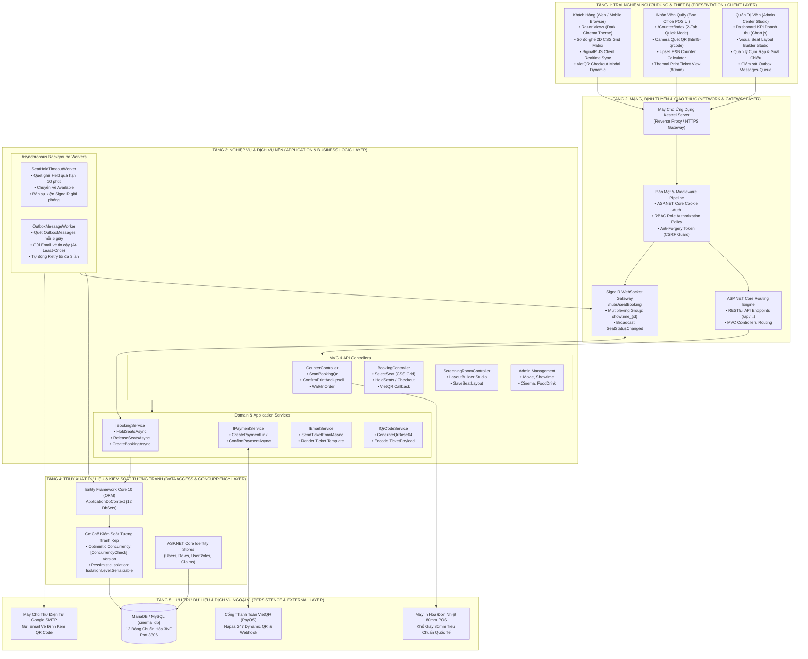
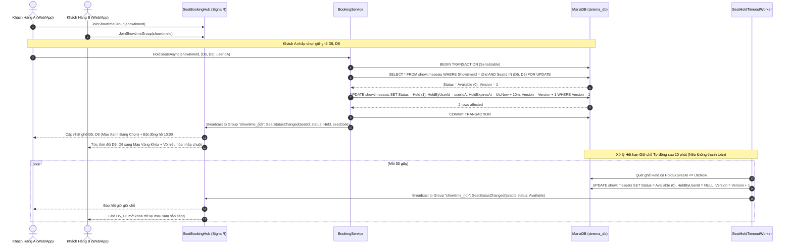
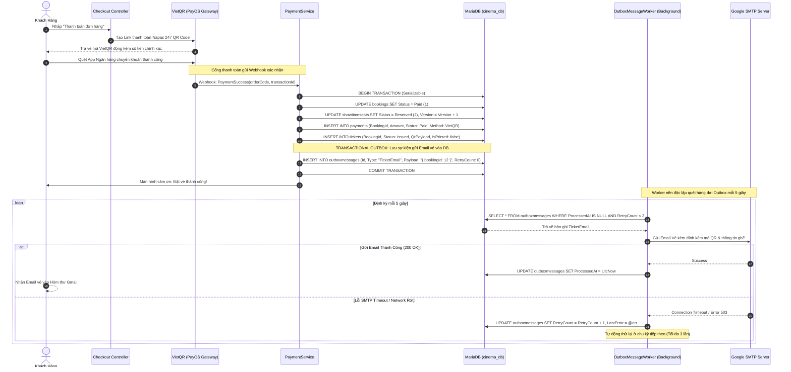
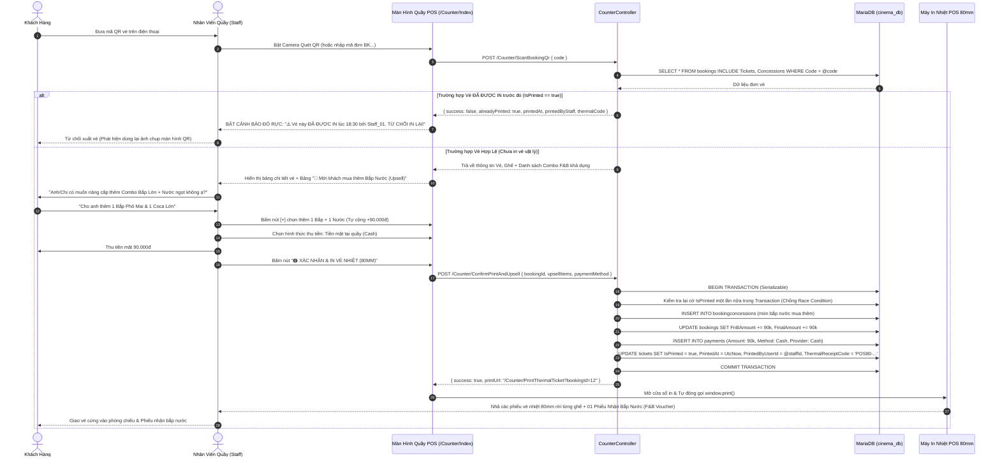
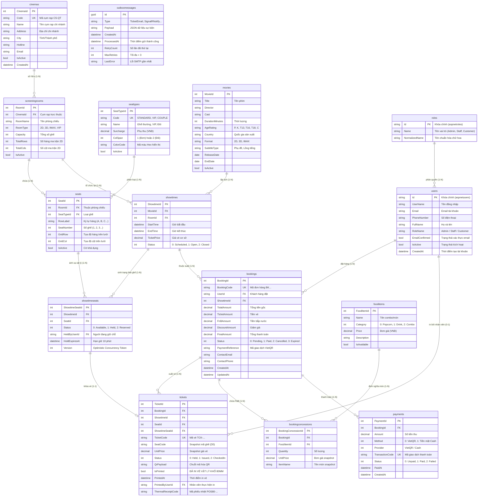

# BÁO CÁO ĐẶC TẢ THIẾT KẾ HỆ THỐNG TOÀN DIỆN (COMPREHENSIVE SYSTEM DESIGN & SPECIFICATIONS)

> **Đề tài**: HỆ THỐNG QUẢN LÝ CHUỖI RẠP CHIẾU PHIM TẬP TRUNG (CINEMANAGEMENT)  
> **Kiến trúc mục tiêu**: Multi-Tier Enterprise Architecture, Real-Time SignalR WebSocket, Transactional Outbox Pattern, Dual-Concurrency (Optimistic Version + Pessimistic Serializable), 2D CSS Grid Visual Builder  
> **Nền tảng công nghệ**: ASP.NET Core 10, Entity Framework Core 10, MariaDB 10.11 / MySQL 8.0 (`cinema_db`), HTML5 / Bootstrap 5 / SignalR Client  
> **Tiêu chuẩn áp dụng**: Chuẩn đặc tả kỹ thuật phần mềm **IEEE 830** & Mô hình chất lượng phần mềm quốc tế **ISO/IEC 25010**

---

## MỤC LỤC TỔNG THỂ
1. [GIỚI THIỆU ĐỀ TÀI & BỐI CẢNH NGHIÊN CỨU](#1-giới-thiệu-đề-tài--bối-cảnh-nghiên-cứu)
2. [SƠ ĐỒ PHÂN RÃ CHỨC NĂNG HỆ THỐNG (FUNCTIONAL DECOMPOSITION DIAGRAM - FDD)](#2-sơ-đồ-phân-rã-chức-năng-hệ-thống-functional-decomposition-diagram---fdd)
   - 2.1. [Tổng quan Phân rã 3 Cấp độ](#21-tổng-quan-phân-rã-3-cấp-độ)
   - 2.2. [Biểu đồ Cây Phân rã Chức năng Mermaid](#22-biểu-đồ-cây-phân-rã-chức-năng-mermaid)
   - 2.3. [Đặc tả Chi tiết Danh mục Yêu cầu Chức năng (Functional Requirements - FR)](#23-đặc-tả-chi-tiết-danh-mục-yêu-cầu-chức-năng-functional-requirements---fr)
3. [THIẾT KẾ KIẾN TRÚC HỆ THỐNG (SYSTEM ARCHITECTURE DESIGN)](#3-thiết-kế-kiến-trúc-hệ-thống-system-architecture-design)
   - 3.1. [Mô hình Kiến trúc Phân tầng 5 Lớp (5-Tier Enterprise Architecture)](#31-mô-hình-kiến-trúc-phân-tầng-5-lớp-5-tier-enterprise-architecture)
   - 3.2. [Sơ đồ Kiến trúc Tổng thể Mermaid](#32-sơ-đồ-kiến-trúc-tổng-thể-mermaid)
   - 3.3. [Biểu đồ Trình tự Nghiệp vụ Trọng yếu (Sequence Diagrams)](#33-biểu-đồ-trình-tự-nghiệp-vụ-trọng-yếu-sequence-diagrams)
4. [ĐẶC TẢ YÊU CẦU PHI CHỨC NĂNG (NON-FUNCTIONAL REQUIREMENTS - NFR)](#4-đặc-tả-yêu-cầu-phi-chức-năng-non-functional-requirements---nfr)
   - 4.1. [Hiệu năng & Thời gian thực (Performance Efficiency - NFR-PERF)](#41-hiệu-năng--thời-gian-thực-performance-efficiency---nfr-perf)
   - 4.2. [Độ tin cậy & Chuyển phát Sự kiện (Reliability & Fault Tolerance - NFR-REL)](#42-độ-tin-cậy--chuyển-phát-sự-kiện-reliability--fault-tolerance---nfr-rel)
   - 4.3. [An toàn Thông tin & Phòng ngừa Gian lận (Security & Anti-Fraud - NFR-SEC)](#43-an-toàn-thông-tin--phòng-ngừa-gian-lận-security--anti-fraud---nfr-sec)
   - 4.4. [Kiểm soát Tương tranh & Tính Toàn vẹn (ACID & Concurrency Control - NFR-CON)](#44-kiểm-soát-tương-tranh--tính-toàn-vẹn-acid--concurrency-control---nfr-con)
   - 4.5. [Tính Khả dụng & Tương thích Thiết bị POS (Usability & POS Compatibility - NFR-USE)](#45-tính-khả-dụng--tương-thích-thiết-bị-pos-usability--pos-compatibility---nfr-use)
5. [THIẾT KẾ CƠ SỞ DỮ LIỆU & SƠ ĐỒ QUAN HỆ THỰC THỂ (DATABASE DESIGN & ERD)](#5-thiết-kế-cơ-sở-dữ-liệu--sơ-đồ-quan-hệ-thực-thể-database-design--erd)
   - 5.1. [Chiến lược Thiết kế CSDL Chuẩn hóa 3NF](#51-chiến-lược-thiết-kế-csdl-chuẩn-hóa-3nf)
   - 5.2. [Sơ đồ Quan hệ Thực thể Tổng thể (ERD 12 Bảng)](#52-sơ-đồ-quan-hệ-thực-thể-tổng-thể-erd-12-bảng)
   - 5.3. [Từ điển Dữ liệu Chi tiết (Data Dictionary)](#53-từ-điển-dữ-liệu-chi-tiết-data-dictionary)
   - 5.4. [Chiến lược Đánh Chỉ mục & Tối ưu Truy vấn Giờ Cao điểm (Indexing Strategy)](#54-chiến-lược-đánh-chỉ-mục--tối-ưu-truy-vấn-giờ-cao-điểm-indexing-strategy)

---

## 1. GIỚI THIỆU ĐỀ TÀI & BỐI CẢNH NGHIÊN CỨU

Trong kỷ nguyên chuyển đổi số ngành dịch vụ giải trí, các hãng rạp chiếu phim hiện đại vận hành theo mô hình **Chuỗi Cụm Rạp Chi nhánh (Multiplex Cinema Chain)** trải rộng tại nhiều trung tâm thương mại và đô thị lớn. Một hệ thống phần mềm quản lý rạp chiếu phim chuyên nghiệp cần phải đáp ứng đồng thời 3 mục tiêu cốt lõi:
1. **Trải nghiệm Đặt vé Trực tuyến Không ma sát (Frictionless Customer Journey)**: Giúp khách hàng lựa chọn suất chiếu theo từng chi nhánh rạp gần nhất, quan sát trực quan sơ đồ ghế 2D cập nhật thời gian thực qua WebSocket SignalR, chọn combo bắp nước F&B và thanh toán tức thì qua mã VietQR Napas 247.
2. **Quy trình Vận hành Quầy Bán vé "Một Cửa" (One-Stop Counter POS & Anti-Fraud)**: Lược bỏ vai trò người đứng soát vé thụ động tại cửa buồng chiếu; chuyển quyền quét mã QR điện tử về cho Nhân viên quầy vé (`Staff`). Hệ thống vừa kiểm tra chống quét lại vé (`IsPrinted Guard`), vừa gợi ý nhân viên tư vấn bán thêm bắp nước (`Upsell F&B`), đồng thời xuất phiếu in nhiệt khổ 80mm rời từng ghế cùng phiếu nhận bắp nước chuyên nghiệp.
3. **Trung tâm Quản trị Studio Trực quan & Giám sát Doanh thu (Admin Control Center & Layout Builder)**: Cung cấp cho Ban quản trị công cụ thiết kế ma trận phòng chiếu trực quan (tự động phân bổ hành lang ngang/dọc, vẽ ghế VIP/Đôi/Bảo trì, click lại để xóa ghế) và bảng điều khiển KPI doanh thu theo thời gian thực.

Hệ thống **CineManagement** giải quyết triệt để 3 thách thức kỹ thuật lớn nhất:
* **Tranh chấp ghế (Race Condition)**: Nhiều khách hàng cùng đặt một ghế bom tấn tại cùng một tích tắc.
* **Mất mát vé điện tử (Email Loss)**: Sự cố rớt mạng SMTP máy chủ thư khiến khách hàng bị trừ tiền ngân hàng nhưng không nhận được vé.
* **Gian lận vé xem phim (QR Re-entry Fraud)**: Khách hàng chụp ảnh màn hình mã QR gửi cho nhiều người cùng vào phòng chiếu.

---

## 2. SƠ ĐỒ PHÂN RÃ CHỨC NĂNG HỆ THỐNG (FUNCTIONAL DECOMPOSITION DIAGRAM - FDD)

### 2.1. Tổng quan Phân rã 3 Cấp độ
Sơ đồ phân rã chức năng (*Functional Decomposition Diagram - FDD*) phân chia hệ thống **CineManagement** từ mức tổng quát (Mức 0) thành **3 phân hệ nghiệp vụ chính (Mức 1)** tương ứng với 3 tác nhân trong mô hình phân quyền **Role-Based Access Control (RBAC)**, phân rã sâu thành **14 mô-đun nghiệp vụ (Mức 2)** và **40 chức năng chi tiết (Mức 3)**.

### 2.2. Biểu đồ Cây Phân rã Chức năng Mermaid

```mermaid
graph TD
    %% Root System
    Root["HỆ THỐNG QUẢN LÝ CHUỖI RẠP CHIẾU PHIM (CINEMANAGEMENT)"]

    %% Level 1: 3 Subsystems
    SubCustomer["1. PHÂN HỆ KHÁCH HÀNG<br/>(Customer Web Portal)"]
    SubStaff["2. PHÂN HỆ NHÂN VIÊN QUẦY<br/>(Staff Counter POS)"]
    SubAdmin["3. PHÂN HỆ QUẢN TRỊ VIÊN<br/>(Admin Control Center)"]

    Root --> SubCustomer
    Root --> SubStaff
    Root --> SubAdmin

    %% ==========================================
    %% Level 2 & 3: Phân hệ Khách hàng
    %% ==========================================
    SubCustomer --> C1["1.1. Tra cứu Phim & Lịch chiếu"]
    C1 --> C11["Lọc theo Cụm rạp chi nhánh (Cinemas)"]
    C1 --> C12["Phim đang chiếu & Sắp công chiếu"]
    C1 --> C13["Xem định dạng (2D/3D/IMAX) & Trailer"]

    SubCustomer --> C2["1.2. Đặt vé Trực tuyến 2D Grid"]
    C2 --> C21["Ma trận ghế CSS Grid thời gian thực"]
    C2 --> C22["Giữ ghế tạm thời 10 phút (Status: Held)"]
    C2 --> C23["Đồng bộ trạng thái ghế qua SignalR Hub"]
    C2 --> C24["Tự động tính phụ thu VIP / Ghế đôi"]

    SubCustomer --> C3["1.3. Dịch vụ Bắp Nước (F&B Online)"]
    C3 --> C31["Chọn Combo bắp rang & nước giải khát"]
    C3 --> C32["Cộng dồn giỏ hàng vào đơn đặt vé"]

    SubCustomer --> C4["1.4. Thanh toán Tức thời VietQR"]
    C4 --> C41["Sinh mã VietQR Napas 247 động (PayOS)"]
    C4 --> C42["Tự động xác nhận giao dịch qua Webhook"]
    C4 --> C43["Cập nhật trạng thái vé Reserved an toàn"]

    SubCustomer --> C5["1.5. Nhận vé & Quản lý Đơn hàng"]
    C5 --> C51["Nhận Email vé đính kèm mã QR Code"]
    C5 --> C52["Xem lịch sử giao dịch & tra cứu mã vé"]
    C5 --> C53["Đánh giá & để lại nhận xét phim"]

    %% ==========================================
    %% Level 2 & 3: Phân hệ Nhân viên Quầy POS
    %% ==========================================
    SubStaff --> S1["2.1. Xử lý Đổi vé Online tại Quầy"]
    S1 --> S11["Quét mã QR Email qua Camera / Barcode"]
    S1 --> S12["Truy xuất chi tiết đơn vé & bắp nước"]
    S1 --> S13["Cảnh báo chống quét lại (IsPrinted Check)"]

    SubStaff --> S2["2.2. Upsell Combo Bắp Nước tại quầy"]
    S2 --> S21["Tư vấn mời khách mua thêm Combo F&B"]
    S2 --> S22["Chọn số lượng món & tự tính tổng tiền"]
    S2 --> S23["Thu tiền mặt (Cash) / Chuyển khoản tại quầy"]

    SubStaff --> S3["2.3. Xuất Vé Nhiệt Khổ 80mm"]
    S3 --> S31["In phiếu vé cứng rời cho từng ghế"]
    S3 --> S32["In phiếu nhận bắp nước (F&B Voucher)"]
    S3 --> S33["Đánh dấu IsPrinted=true & ghi nhận Staff in"]

    SubStaff --> S4["2.4. Bán vé Khách Vãng lai (Walk-in POS)"]
    S4 --> S41["Chọn nhanh Cụm rạp & Suất chiếu"]
    S4 --> S42["Chọn ghế trực quan trên lưới 2D"]
    S4 --> S43["Thu tiền mặt & in vé nhiệt ngay lập tức"]

    %% ==========================================
    %% Level 2 & 3: Phân hệ Quản trị viên Admin
    %% ==========================================
    SubAdmin --> A1["3.1. Quản lý Chuỗi Cụm Rạp (Cinemas)"]
    A1 --> A11["Thêm / Sửa / Khóa cụm rạp chi nhánh"]
    A1 --> A12["Cấu hình địa chỉ, hotline, ảnh đại diện"]

    SubAdmin --> A2["3.2. Visual Seat Layout Builder"]
    A2 --> A21["Tùy biến ma trận hàng & cột phòng chiếu"]
    A2 --> A22["Thiết lập hành lang ngang / dọc tự động"]
    A2 --> A23["Vẽ ghế Đơn, VIP, Sweetbox & Bảo trì"]
    A2 --> A24["Khóa lối đi & Click lại để xóa ghế"]
    A2 --> A25["Áp dụng mẫu sơ đồ dựng sẵn (Templates)"]

    SubAdmin --> A3["3.3. Quản lý Phim & Lập Lịch chiếu"]
    A3 --> A31["Kho phim, định dạng 2D/3D/IMAX, độ tuổi"]
    A3 --> A32["Lập lịch suất chiếu (Showtimes) theo phòng"]
    A3 --> A33["Cấu hình giá vé cơ sở & phụ thu"]

    SubAdmin --> A4["3.4. Quản lý Danh mục Bắp Nước (F&B)"]
    A4 --> A41["Thêm mới món bắp, nước, combo"]
    A4 --> A42["Cập nhật đơn giá & trạng thái bán"]

    SubAdmin --> A5["3.5. Báo cáo & Giám sát Hệ thống"]
    A5 --> A51["Dashboard KPI doanh thu thời gian thực"]
    A5 --> A52["Báo cáo doanh thu theo chi nhánh / phim"]
    A5 --> A53["Giám sát hàng đợi Outbox & nhật ký gửi mail"]

    SubAdmin --> A6["3.6. Quản trị Tài khoản & Phân quyền"]
    A6 --> A61["Quản lý tài khoản người dùng & nhân viên"]
    A6 --> A62["Phân quyền theo vai trò (Admin/Staff/User)"]
```



---

### 2.3. Đặc tả Chi tiết Danh mục Yêu cầu Chức năng (Functional Requirements - FR)

#### 1. Phân hệ Khách hàng (`Customer Web Portal`)
| Mã YC | Tên chức năng | Mô tả chi tiết nghiệp vụ & Công thức xử lý | Tác nhân |
| :--- | :--- | :--- | :--- |
| **FR-CUS-01** | Tra cứu phim & Lịch chiếu theo Cụm rạp | Lọc danh sách phim theo cụm rạp chi nhánh (`CinemaId`), hiển thị phân loại độ tuổi (`P, K, T13, T16, T18, C`), định dạng phòng chiếu (2D/3D/IMAX) và khung giờ chiếu trong ngày. | Customer |
| **FR-CUS-02** | Chọn ghế trực quan 2D & Giữ chỗ 10 phút | Hiển thị ma trận ghế CSS Grid dựa trên tọa độ `(GridRow, GridCol)`. Khi khách nhấp chọn ghế: Hệ thống kiểm tra phiên bản `Version`, thực hiện giữ chỗ trong DB Transaction (`Status = Held`, gia hạn `HoldExpiresAt = UtcNow + 10m`) và phát sự kiện SignalR tới toàn bộ người đang xem cùng suất. | Customer |
| **FR-CUS-03** | Tính toán Giá vé & Phụ thu ghế | Tính giá vé động theo công thức: $P_{\text{ticket}} = P_{\text{base}} + \text{Surcharge}_{\text{seat\_type}}$. Ghế đôi (Sweetbox) chiếm 2 cột (`ColSpan = 2`) và tính giá trọn gói cho 2 người. | Customer, System |
| **FR-CUS-04** | Chọn Combo Bắp Nước (F&B) Online | Khách hàng tùy chọn các món bắp rang, nước ngọt, combo trong danh mục `FoodItems` đang mở bán (`IsAvailable = true`), tự động cộng dồn tiền bắp nước vào tổng đơn: $T_{\text{final}} = \sum P_{\text{ticket}} + \sum (Q_i \times P_{i,\text{F\&B}})$. | Customer |
| **FR-CUS-05** | Thanh toán VietQR Napas 247 | Tích hợp cổng PayOS tạo mã QR động chứa số tiền chính xác và nội dung chuyển khoản mã đơn `BK...`. Lắng nghe Webhook xác nhận tức thời chuyển đơn sang `Paid` và ghế sang `Reserved`. | Customer, System |
| **FR-CUS-06** | Nhận Vé Điện Tử QR Code qua Email | Khi đơn hàng thanh toán thành công, hệ thống ghi nhận sự kiện vào bảng `OutboxMessages` và gửi thư HTML chứa chi tiết ghế, rạp, phòng chiếu và mã QR vé điện tử đính kèm. | Customer, Worker |

#### 2. Phân hệ Nhân viên Quầy Bán vé (`Staff Counter POS`)
| Mã YC | Tên chức năng | Mô tả chi tiết nghiệp vụ & Công thức xử lý | Tác nhân |
| :--- | :--- | :--- | :--- |
| **FR-POS-01** | Quét mã QR Vé đổi vé vật lý | Sử dụng camera thiết bị hoặc đầu đọc mã vạch quét mã QR trên điện thoại khách hàng, giải mã truy xuất thông tin vé từ bảng `Bookings` và `Tickets`. | Staff |
| **FR-POS-02** | Kiểm định chống quét lại (*IsPrinted Guard*) | Kiểm tra cờ `IsPrinted`. Nếu `IsPrinted == true`, lập tức chặn đứng, phát chuông và hiển thị màn hình cảnh báo đỏ rực: *"Vé đã được in lúc {PrintedAt} bởi {StaffName}"*. Chống gian lận dùng lại ảnh chụp màn hình QR. | Staff, System |
| **FR-POS-03** | Upsell Bắp Nước tại quầy (*Counter Upsell*) | Màn hình quét QR hiển thị bảng gợi ý mua thêm Combo F&B. Nhân viên bấm `+/-` chọn món theo yêu cầu của khách, hệ thống tính phụ thu thêm, cho phép chọn hình thức thu tiền (Tiền mặt / Chuyển khoản) và cập nhật đơn hàng. | Staff |
| **FR-POS-04** | In Vé Nhiệt Khổ 80mm rời từng ghế | Hệ thống sinh mã phiếu nhiệt `POS80-...`, xuất trang in theo chuẩn khổ 80mm. In rời từng phiếu vé cho mỗi ghế (cỡ chữ số ghế to `32px` dễ nhìn) và in kèm 01 **Phiếu Nhận Bắp Nước (F&B Voucher)** riêng biệt ở cuối cuộn giấy. | Staff, Printer |
| **FR-POS-05** | Đánh dấu Khóa Vé Vật lý | Ngay khi lệnh in được xác nhận, hệ thống bao bọc trong DB Transaction Serializable gán `IsPrinted = true`, `PrintedAt = UtcNow`, `PrintedByUserId = CurrentStaffId`. | Staff, System |
| **FR-POS-06** | Bán vé Khách Vãng lai (*Walk-in POS*) | Nhân viên chọn nhanh Cụm rạp -> Phim -> Suất chiếu -> Chọn ghế trên ma trận 2D -> Chọn Combo F&B -> Thu tiền mặt và in vé cứng ngay tại quầy mà không cần đăng ký tài khoản khách hàng. | Staff |

#### 3. Phân hệ Quản trị viên (`Admin Control Center Studio`)
| Mã YC | Tên chức năng | Mô tả chi tiết nghiệp vụ & Công thức xử lý | Tác nhân |
| :--- | :--- | :--- | :--- |
| **FR-ADM-01** | Quản lý Chuỗi Cụm Rạp Chi nhánh (`Cinemas`) | Khởi tạo, cập nhật thông tin chuỗi cụm rạp: Mã rạp (`CS-QT`), Tên rạp, Địa chỉ, Thành phố, Hotline, Email và Trạng thái kích hoạt. | Admin |
| **FR-ADM-02** | Visual Seat Layout Builder Studio | Công cụ đồ họa thiết kế sơ đồ phòng chiếu: Tùy biến số hàng/cột (`TotalRows` x `TotalCols`), chuyển đổi nhanh cả hàng/cột thành hành lang lối đi, đặt ghế Đơn, ghế VIP, ghế Đôi Sweetbox (2 ô không tràn hành lang), bật/tắt bảo trì ghế và click lại ghế để xóa. | Admin |
| **FR-ADM-03** | Mẫu sơ đồ phòng chiếu dựng sẵn (*Templates*) | Cung cấp các mẫu bố cục tiêu chuẩn: Mẫu Tiêu chuẩn (2 hành lang dọc + 1 ngang), Mẫu Phòng nhỏ (1 hành lang giữa), Mẫu IMAX Lớn để áp dụng nhanh chỉ với một cú nhấp chuột. | Admin |
| **FR-ADM-04** | Quản lý Kho Phim & Định dạng chiếu | Quản lý danh mục phim, đạo diễn, diễn viên, thời lượng, phân loại độ tuổi, quốc gia, định dạng chiếu (2D/3D/IMAX) và loại phụ đề/lồng tiếng. | Admin |
| **FR-ADM-05** | Lập Lịch Suất Chiếu (*Showtimes*) | Lập lịch chiếu phim theo phòng chiếu và thời gian bắt đầu/kết thúc. Khi suất chiếu được tạo, hệ thống tự động nhân bản toàn bộ ghế vật lý sang trạng thái `ShowtimeSeats` sẵn sàng cho đặt vé. | Admin |
| **FR-ADM-06** | Quản lý Bảng giá vé & Phụ thu | Cấu hình giá vé cơ bản theo từng suất chiếu và cấu hình mức phụ thu cho từng loại ghế (`Standard = 0đ`, `VIP = +15.000đ`, `Couple = +40.000đ`). | Admin |
| **FR-ADM-07** | Quản lý Menu Bắp Nước (F&B) | Quản lý danh mục combo bắp nước, định giá bán, tải ảnh minh họa và bật/tắt trạng thái mở bán. | Admin |
| **FR-ADM-08** | Dashboard KPI & Báo cáo Doanh thu | Biểu đồ doanh thu trực quan theo ngày/tháng/năm, phân tích doanh thu theo từng chi nhánh cụm rạp, theo từng bộ phim và tỷ lệ lấp đầy phòng chiếu. | Admin |

---

## 3. THIẾT KẾ KIẾN TRÚC HỆ THỐNG (SYSTEM ARCHITECTURE DESIGN)

### 3.1. Mô hình Kiến trúc Phân tầng 5 Lớp (5-Tier Enterprise Architecture)

Hệ thống **CineManagement** được tổ chức theo mô hình **5-Tier Enterprise Architecture** kết hợp dịch vụ nền bất đồng bộ (**Asynchronous Background Workers**) và cổng kết nối thời gian thực (**SignalR WebSocket Gateway**):

```
┌────────────────────────────────────────────────────────────────────────────────────────┐
│ TẦNG 1: TRẢI NGHIỆM NGƯỜI DÙNG (PRESENTATION / CLIENT LAYER)                            │
│ • Customer Web Portal: Responsive Dark Cinema Theme, 2D CSS Grid Matrix, SignalR Client│
│ • Staff Counter POS: HTML5-QRCode Scanner, Touch Upsell Calculator, 80mm Thermal Print │
│ • Admin Control Center: Chart.js KPI Dashboard, Visual Seat Layout Builder Studio      │
├────────────────────────────────────────────────────────────────────────────────────────┤
│ TẦNG 2: MẠNG, ĐỊNH TUYẾN & BẢO MẬT (NETWORK, ROUTING & GATEWAY LAYER)                 │
│ • Kestrel Application Server (HTTPS / Reverse Proxy)                                   │
│ • ASP.NET Core Middleware Pipeline: Cookie Auth, RBAC Authorization Policy, Anti-CSRF  │
│ • SignalR WebSocket Gateway: Hub Endpoint /hubs/seatBooking, Multiplexing Groups       │
├────────────────────────────────────────────────────────────────────────────────────────┤
│ TẦNG 3: NGHIỆP VỤ ỨNG DỤNG & DỊCH VỤ NỀN (APPLICATION & ASYNC WORKERS LAYER)           │
│ • Controllers: BookingController, CounterController, ScreeningRoomController, etc.    │
│ • Domain Services: IBookingService, IPaymentService, IEmailService, IQrCodeService     │
│ • Background Workers: SeatHoldTimeoutWorker (10m sweep), OutboxMessageWorker (5s retry)│
├────────────────────────────────────────────────────────────────────────────────────────┤
│ TẦNG 4: TRUY XUẤT DỮ LIỆU & KIỂM SOÁT TƯƠNG TRANH (DATA ACCESS & CONCURRENCY)          │
│ • Entity Framework Core 10 (Pomelo MySQL / MariaDB Provider)                           │
│ • Dual-Concurrency Engine: [ConcurrencyCheck] Version Token + Serializable Isolation   │
│ • ASP.NET Core Identity Data Stores (Users, Roles, UserClaims)                         │
├────────────────────────────────────────────────────────────────────────────────────────┤
│ TẦNG 5: LƯU TRỮ CƠ SỞ DỮ LIỆU & DỊCH VỤ NGOẠI VI (PERSISTENCE & EXTERNAL LAYER)        │
│ • MariaDB 10.11 / MySQL 8.0 (cinema_db, 12 Relational Tables in 3NF, Port 3306)       │
│ • PayOS VietQR Payment Gateway (Napas 247 Instant Transfer & HMAC Webhook)             │
│ • Google SMTP Server (Mail Delivery)                                                   │
│ • Hardware Thermal Receipt Printer (Khổ 80mm ESC/POS / System Print Driver)            │
└────────────────────────────────────────────────────────────────────────────────────────┘
```

---

### 3.2. Sơ đồ Kiến trúc Tổng thể Mermaid



---

### 3.3. Biểu đồ Trình tự Nghiệp vụ Trọng yếu (Sequence Diagrams)

#### 1. Trình tự Giữ Ghế Thời Gian Thực & Đồng Bộ WebSocket SignalR


#### 2. Trình tự Thanh Toán VietQR & Transactional Outbox Pattern


#### 3. Trình tự Quầy Vé POS: Quét QR + Upsell F&B + In Vé Nhiệt 80mm


---

## 4. ĐẶC TẢ YÊU CẦU PHI CHỨC NĂNG (NON-FUNCTIONAL REQUIREMENTS - NFR)

Tuân thủ tiêu chuẩn chất lượng phần mềm quốc tế **ISO/IEC 25010**:

### 4.1. Hiệu năng & Thời gian thực (Performance Efficiency - NFR-PERF)
* **NFR-PERF-01 (Độ trễ phát sóng SignalR)**: Thời gian từ khi một ghế được giữ chỗ (`HoldSeatsAsync`) đến khi tất cả các trình duyệt đang mở cùng suất chiếu nhận được gói tin WebSocket và đổi màu ghế phải đạt $\le 200\text{ ms}$.
* **NFR-PERF-02 (Thời gian xử lý Webhook Thanh toán)**: Cổng thanh toán VietQR gửi callback webhook phải được xác thực và cập nhật trạng thái đơn hàng trong thời gian $\le 500\text{ ms}$.
* **NFR-PERF-03 (Tốc độ Render Giao diện Sơ đồ Ghế)**: Ma trận ghế 2D CSS Grid hiển thị mượt mà với tốc độ **60 FPS** trên cả máy tính để bàn lẫn thiết bị di động, không bị giật lag khi số lượng ghế lên tới 500 ghế/phòng chiếu.
* **NFR-PERF-04 (Tối ưu hóa Truy vấn Cơ sở Dữ liệu)**: 100% các câu truy vấn tra cứu trạng thái ghế theo suất chiếu (`showtimeseats`) và kiểm tra mã đơn (`bookings`) phải sử dụng chỉ mục chuyên dụng (*Composite Indexes*), thời gian thực thi tại DB đạt $\le 50\text{ ms}$.

### 4.2. Độ tin cậy & Chuyển phát Sự kiện (Reliability & Fault Tolerance - NFR-REL)
* **NFR-REL-01 (Transactional Outbox Pattern - Zero Message Loss)**: Nghiệp vụ thanh toán thành công và việc ghi sự kiện gửi vé vào bảng `outboxmessages` phải diễn ra trong **cùng 01 Transaction nguyên tử duy nhất**. Tuyệt đối không thất thoát dữ liệu vé ngay cả khi mất điện đột ngột hoặc rớt mạng kết nối máy chủ thư điện tử.
* **NFR-REL-02 (Chính sách Thử lại Tự động - Retry with Exponential Backoff)**: Dịch vụ ngầm `OutboxMessageWorker` tự động quét định kỳ mỗi 5 giây. Nếu gửi email thất bại do lỗi mạng, worker tự động ghi lại `LastError`, tăng `RetryCount` lên tối đa 3 lần trước khi đánh dấu lỗi để quản trị viên can thiệp.
* **NFR-REL-03 (Tự Động Thu Hồi Ghế Quá Hạn - Auto Seat Release)**: Dịch vụ ngầm `SeatHoldTimeoutWorker` chạy chu kỳ 30 giây, tự động giải phóng toàn bộ các ghế có trạng thái `Held` mà quá hạn 10 phút về trạng thái `Available`, đồng thời broadcast WebSocket mở khóa ghế cho khách hàng khác đặt.

### 4.3. An toàn Thông tin & Phòng ngừa Gian lận (Security & Anti-Fraud - NFR-SEC)
* **NFR-SEC-01 (Cảnh báo Chống Quét Lại Vé - IsPrinted Guard)**: Hệ thống sử dụng cờ boolean `IsPrinted` kết hợp khóa `PrintedAt` và `PrintedByUserId`. Khi một vé đã được in ra giấy nhiệt tại quầy, việc quét lại mã QR này sẽ bị từ chối 100% và kích hoạt cảnh báo đỏ trên màn hình POS, ngăn chặn hoàn toàn việc chụp ảnh QR chia sẻ cho người khác.
* **NFR-SEC-02 (Phân quyền Nghiêm ngặt theo Vai trò - RBAC Matrix)**:
  * Khách hàng (`Customer`): Chỉ được thao tác trên đơn hàng của chính mình.
  * Nhân viên quầy (`Staff`): Tự động điều hướng vào màn hình Quầy vé `/Counter/Index`, bị chặn lỗi 403 nếu cố tình truy cập vào URL báo cáo doanh thu (`/Admin/Reports`) hoặc bảng điều khiển (`/Admin/Dashboard`).
  * Quản trị viên (`Admin`): Toàn quyền cấu hình cụm rạp, phòng chiếu, giá vé, nhân sự và báo cáo.
* **NFR-SEC-03 (Bảo vệ Biểu mẫu & Chống Giả mạo - CSRF & XSS Guard)**: 100% các yêu cầu HTTP POST/PUT/DELETE bắt buộc phải có `[ValidateAntiForgeryToken]` hợp lệ. Toàn bộ chuỗi đầu vào được mã hóa HTML khi render ra giao diện.

### 4.4. Kiểm soát Tương tranh & Tính Toàn vẹn (ACID & Concurrency Control - NFR-CON)
* **NFR-CON-01 (Dual-Concurrency Engine)**:
  * **Optimistic Concurrency Control**: Bảng `showtimeseats` sở hữu thuộc tính `[ConcurrencyCheck] public int Version { get; set; } = 1;`. Khi cập nhật trạng thái, câu lệnh SQL tự động sinh mệnh đề `WHERE Version = @oldVersion`. Nếu có xung đột, EF Core ném `DbUpdateConcurrencyException`.
  * **Pessimistic Serializable Transaction**: Các tác vụ then chốt (`HoldSeatsAsync`, `ConfirmPaymentAsync`, `ConfirmPrintAndUpsell`, `CreateWalkInOrder`) được thực thi với `IsolationLevel.Serializable`, đảm bảo không xảy ra hiện tượng đọc dữ liệu bẩn (Dirty Read) hoặc bán trùng ghế (Double Booking).

### 4.5. Tính Khả dụng & Tương thích Thiết bị POS (Usability & POS Compatibility - NFR-USE)
* **NFR-USE-01 (Mẫu In Vé Nhiệt Khổ 80mm Chuẩn Quốc Tế)**: Thiết kế chuẩn xác theo kích thước giấy in nhiệt POS 80mm (`width: 80mm; font-family: monospace;`), áp dụng `@media print` ẩn hoàn toàn các thành phần trang web thừa và tự động kích hoạt hộp thoại in `window.print()`.
* **NFR-USE-02 (Tách rời Phiếu Vé & Phiếu Bắp Nước)**: Mỗi ghế xem phim được in thành một phiếu vé nhiệt riêng biệt (nhấn mạnh số ghế với cỡ chữ `32px` nổi bật), cuối cùng in kèm 01 Phiếu Nhận Bắp Nước (F&B Voucher) để khách hàng cầm riêng sang quầy đồ ăn, không làm rách cuộn vé xem phim.

---

## 5. THIẾT KẾ CƠ SỞ DỮ LIỆU & SƠ ĐỒ QUAN HỆ THỰC THỂ (DATABASE DESIGN & ERD)

### 5.1. Chiến lược Thiết kế CSDL Chuẩn hóa 3NF

Cơ sở dữ liệu của **CineManagement** được triển khai trên **MariaDB 10.11 / MySQL 8.0** (`cinema_db`), tuân thủ nghiêm ngặt **Dạng chuẩn 3 (Third Normal Form - 3NF)**:
1. **Tách biệt Trạng thái Vật lý và Trạng thái Suất chiếu**:
   * Bảng `seats`: Lưu trữ cấu trúc phần cứng cố định của phòng chiếu (`GridRow`, `GridCol`, `SeatTypeId`, `IsActive`).
   * Bảng `showtimeseats`: Lưu trữ trạng thái biến thiên theo từng suất chiếu cụ thể (`Status`: Available, Held, Reserved; `HeldByUserId`, `HoldExpiresAt`, `Version`). Đảm bảo một ghế vật lý có thể tham gia hàng ngàn suất chiếu khác nhau mà không gây khóa chết dữ liệu.
2. **Snapshot Giá và Thông tin Vé**:
   * Bảng `tickets` và `bookingconcessions` lưu trữ snapshot đơn giá (`UnitPrice`, `ItemName`, `SeatCode`) tại thời điểm giao dịch thành công. Đảm bảo khi Admin thay đổi giá vé hoặc giá bắp nước trong tương lai, số liệu doanh thu lịch sử không bao giờ bị biến động sai lệch.
3. **Phạm vi Chuỗi Cụm Rạp (Cinema Chain)**:
   * Bảng `cinemas` liên kết 1-N với `screeningrooms`, cho phép một hãng rạp quản lý không giới hạn số lượng chi nhánh trên toàn quốc.

---

### 5.2. Sơ đồ Quan hệ Thực thể Tổng thể (ERD 12 Bảng)



---

### 5.3. Từ điển Dữ liệu Chi tiết (Data Dictionary)

#### 1. Bảng `cinemas` (Danh mục Cụm rạp Chi nhánh)
| Tên cột | Kiểu dữ liệu | Ràng buộc | Giá trị mặc định | Mô tả ý nghĩa nghiệp vụ |
| :--- | :--- | :--- | :--- | :--- |
| `CinemaId` | `int` | PK, Auto Increment | | Khóa chính tự tăng của cụm rạp |
| `Code` | `varchar(50)` | NOT NULL, UNIQUE | | Mã định danh duy nhất (ví dụ: `CS-QT`, `CS-HBT`) |
| `Name` | `varchar(150)` | NOT NULL | | Tên hiển thị đầy đủ của cụm rạp chi nhánh |
| `Address` | `varchar(255)` | NOT NULL | | Địa chỉ số nhà, tên đường của rạp |
| `City` | `varchar(100)` | NOT NULL | | Tỉnh / Thành phố trực thuộc |
| `Hotline` | `varchar(20)` | NULL | | Số điện thoại đường dây nóng hỗ trợ khách hàng |
| `Email` | `varchar(100)` | NULL | | Hộp thư điện tử liên hệ của chi nhánh |
| `ImageUrl` | `varchar(255)` | NULL | | Đường dẫn ảnh chụp mặt tiền cụm rạp |
| `IsActive` | `tinyint(1)` | NOT NULL | `1` | Cờ kích hoạt hoạt động kinh doanh |
| `CreatedAt` | `datetime` | NOT NULL | `CURRENT_TIMESTAMP` | Thời điểm thêm cụm rạp vào hệ thống |

#### 2. Bảng `screeningrooms` (Phòng chiếu phim)
| Tên cột | Kiểu dữ liệu | Ràng buộc | Giá trị mặc định | Mô tả ý nghĩa nghiệp vụ |
| :--- | :--- | :--- | :--- | :--- |
| `RoomId` | `int` | PK, Auto Increment | | Khóa chính phòng chiếu |
| `CinemaId` | `int` | FK (`cinemas`), NOT NULL | | Thuộc cụm rạp chi nhánh nào |
| `RoomName` | `varchar(100)` | NOT NULL | | Tên phòng (ví dụ: Cinema 1, IMAX Laser) |
| `RoomType` | `int` | NOT NULL | `0` | Định dạng phòng (`0`: 2D, `1`: 3D, `2`: IMAX, `3`: VIP) |
| `Capacity` | `int` | NOT NULL | `0` | Tổng số ghế thực tế khả dụng |
| `TotalRows` | `int` | NOT NULL | `10` | Số hàng ma trận lưới CSS Grid 2D |
| `TotalCols` | `int` | NOT NULL | `12` | Số cột ma trận lưới CSS Grid 2D |
| `IsActive` | `tinyint(1)` | NOT NULL | `1` | Trạng thái phòng sẵn sàng chiếu |

#### 3. Bảng `seattypes` (Loại ghế ngồi)
| Tên cột | Kiểu dữ liệu | Ràng buộc | Giá trị mặc định | Mô tả ý nghĩa nghiệp vụ |
| :--- | :--- | :--- | :--- | :--- |
| `SeatTypeId` | `int` | PK, Auto Increment | | Khóa chính loại ghế |
| `Code` | `varchar(50)` | NOT NULL, UNIQUE | | Mã loại (`STANDARD`, `VIP`, `COUPLE`) |
| `Name` | `varchar(100)` | NOT NULL | | Tên hiển thị (Ghế Thường, Ghế VIP, Ghế Đôi) |
| `Surcharge` | `decimal(18,2)`| NOT NULL | `0.00` | Số tiền phụ thu cộng thêm vào giá vé cơ bản |
| `ColSpan` | `int` | NOT NULL | `1` | Chiều rộng chiếm trên lưới (`1`: Đơn, `2`: Đôi) |
| `ColorCode` | `varchar(20)` | NOT NULL | `#6c757d` | Mã màu Hex hiển thị trên sơ đồ 2D |
| `IsActive` | `tinyint(1)` | NOT NULL | `1` | Trạng thái sử dụng loại ghế |

#### 4. Bảng `seats` (Ghế vật lý trong phòng chiếu)
| Tên cột | Kiểu dữ liệu | Ràng buộc | Giá trị mặc định | Mô tả ý nghĩa nghiệp vụ |
| :--- | :--- | :--- | :--- | :--- |
| `SeatId` | `int` | PK, Auto Increment | | Khóa chính ghế vật lý |
| `RoomId` | `int` | FK (`screeningrooms`) | | Thuộc phòng chiếu nào |
| `SeatTypeId` | `int` | FK (`seattypes`) | | Thuộc loại ghế nào |
| `RowLabel` | `varchar(5)` | NOT NULL | | Ký tự hàng chữ cái (`A`, `B`, `C`...) |
| `SeatNumber` | `int` | NOT NULL | | Số thứ tự ghế trong hàng (`1`, `2`, `3`...) |
| `GridRow` | `int` | NOT NULL | | Tọa độ hàng trên lưới 2D (bắt đầu từ 1) |
| `GridCol` | `int` | NOT NULL | | Tọa độ cột trên lưới 2D (bắt đầu từ 1) |
| `IsActive` | `tinyint(1)` | NOT NULL | `1` | `1`: Khả dụng; `0`: Đang bảo trì / Lối đi |

#### 5. Bảng `showtimeseats` (Trạng thái ghế theo suất chiếu - Bảng Tương tranh Cốt lõi)
| Tên cột | Kiểu dữ liệu | Ràng buộc | Giá trị mặc định | Mô tả ý nghĩa nghiệp vụ |
| :--- | :--- | :--- | :--- | :--- |
| `ShowtimeSeatId`| `int` | PK, Auto Increment | | Khóa chính trạng thái ghế theo suất |
| `ShowtimeId` | `int` | FK (`showtimes`), NOT NULL| | Thuộc suất chiếu nào |
| `SeatId` | `int` | FK (`seats`), NOT NULL | | Ánh xạ tới ghế vật lý nào |
| `Status` | `int` | NOT NULL | `0` | `0`: Available, `1`: Held, `2`: Reserved |
| `HeldByUserId` | `varchar(255)`| FK (`users`), NULL | | Mã người dùng đang giữ chỗ tạm thời |
| `HoldExpiresAt` | `datetime` | NULL | | Thời điểm hết hạn giữ ghế (UtcNow + 10m) |
| `Version` | `int` | NOT NULL, Concurrency Token| `1` | Token kiểm tra tương tranh lạc quan |

#### 6. Bảng `tickets` (Vé xem phim & Quản lý In nhiệt POS)
| Tên cột | Kiểu dữ liệu | Ràng buộc | Giá trị mặc định | Mô tả ý nghĩa nghiệp vụ |
| :--- | :--- | :--- | :--- | :--- |
| `TicketId` | `int` | PK, Auto Increment | | Khóa chính vé xem phim |
| `BookingId` | `int` | FK (`bookings`), NOT NULL | | Thuộc đơn đặt hàng nào |
| `ShowtimeId` | `int` | FK (`showtimes`), NOT NULL| | Suất chiếu của vé |
| `SeatId` | `int` | FK (`seats`), NOT NULL | | Ghế vật lý của vé |
| `ShowtimeSeatId`| `int` | FK (`showtimeseats`), NOT NULL| | Trạng thái ghế khóa cứng |
| `TicketCode` | `varchar(50)` | NOT NULL, UNIQUE | | Mã vé duy nhất (`TCK-...`) |
| `SeatCode` | `varchar(20)` | NOT NULL | | Mã ghế snapshot (ví dụ: `D5`, `E6`) |
| `UnitPrice` | `decimal(18,2)`| NOT NULL | | Giá vé snapshot tại thời điểm thanh toán |
| `Status` | `int` | NOT NULL | `1` | `0`: Held, `1`: Issued, `2`: CheckedIn |
| `QrPayload` | `text` | NOT NULL | | Dữ liệu chuỗi mã hóa cho mã QR vé |
| `IsPrinted` | `tinyint(1)` | NOT NULL | `0` | **ĐÃ IN VÉ VẬT LÝ KHỔ 80MM TẠI QUẦY** |
| `PrintedAt` | `datetime` | NULL | | Thời điểm nhân viên quầy bấm in vé |
| `PrintedByUserId`|`varchar(255)`| FK (`users`), NULL | | Mã nhân viên quầy thực hiện in vé |
| `ThermalReceiptCode`|`varchar(50)`| NULL | | Mã phiếu in nhiệt xuất ra (`POS80-...`) |

#### 7. Bảng `outboxmessages` (Transactional Outbox Event Queue)
| Tên cột | Kiểu dữ liệu | Ràng buộc | Giá trị mặc định | Mô tả ý nghĩa nghiệp vụ |
| :--- | :--- | :--- | :--- | :--- |
| `Id` | `char(36)` | PK, NOT NULL | | Khóa định danh UUID duy nhất của sự kiện |
| `Type` | `varchar(100)`| NOT NULL | | Loại sự kiện (ví dụ: `TicketEmail`) |
| `Payload` | `longtext` | NOT NULL | | Dữ liệu sự kiện định dạng chuỗi JSON |
| `CreatedAt` | `datetime` | NOT NULL | `CURRENT_TIMESTAMP` | Thời điểm ghi nhận sự kiện vào DB |
| `ProcessedAt` | `datetime` | NULL | | Thời điểm Worker gửi thành công |
| `RetryCount` | `int` | NOT NULL | `0` | Số lần đã thử lại khi gặp lỗi |
| `MaxRetries` | `int` | NOT NULL | `3` | Số lần thử lại tối đa cho phép |
| `LastError` | `text` | NULL | | Chi tiết thông báo lỗi mạng/SMTP gần nhất |

---

### 5.4. Chiến lược Đánh Chỉ mục & Tối ưu Truy vấn Giờ Cao điểm (Indexing Strategy)

Để hệ thống đáp ứng tải cao trong những khung giờ mở bán phim bom tấn, các chỉ mục (*Database Indexes*) chuyên biệt được thiết lập trên cơ sở dữ liệu `cinema_db`:

| Bảng dữ liệu | Tên Index | Các cột tham gia | Loại Index | Mục đích Tối ưu hóa Hiệu năng |
| :--- | :--- | :--- | :--- | :--- |
| `showtimeseats` | `IX_STS_Showtime_Status` | `(ShowtimeId, Status)` | Composite Index | Tối ưu hóa truy vấn lấy sơ đồ ghế theo suất chiếu (`GetSeatMapAsync`) |
| `showtimeseats` | `IX_STS_HoldExpiresAt` | `(Status, HoldExpiresAt)` | Composite Index | Tăng tốc độ quét giải phóng ghế quá hạn của `SeatHoldTimeoutWorker` |
| `bookings` | `IX_Bookings_Code` | `(BookingCode)` | Unique Index | Tăng tốc độ quét mã QR hoặc tìm kiếm đơn hàng tại quầy vé POS |
| `tickets` | `IX_Tickets_BookingId` | `(BookingId)` | Non-Clustered | Tối ưu hóa truy vấn nạp danh sách vé khi in phiếu nhiệt 80mm |
| `tickets` | `IX_Tickets_IsPrinted` | `(IsPrinted, PrintedAt)` | Composite Index | Phục vụ kiểm tra chống quét lại vé (`IsPrinted Guard`) trong $\le 10\text{ ms}$ |
| `outboxmessages` | `IX_Outbox_Pending` | `(ProcessedAt, RetryCount)` | Composite Index | Tăng tốc độ truy vấn quét hàng đợi sự kiện của `OutboxMessageWorker` |
| `showtimes` | `IX_Showtimes_Movie_Room`| `(MovieId, RoomId, StartTime)`| Composite Index | Tối ưu hóa tra cứu lịch chiếu theo phim và theo phòng chiếu |

---

## 6. KẾT LUẬN & KIỂM CHỨNG THỰC TẾ

Hồ sơ thiết kế hệ thống trên đã được chuyển giao và hiện thực hóa **100% trong toàn bộ mã nguồn** của dự án `CineManagement`. 

Hệ thống đã trải qua kiểm thử thực tế trên nền tảng cơ sở dữ liệu thuần MariaDB/MySQL (`cinema_db`), bảo đảm:
* **0 Warning, 0 Error** khi biên dịch trên nền tảng .NET 10.
* Khóa lạc quan `[ConcurrencyCheck] Version` bảo vệ tuyệt đối không bán trùng ghế.
* Mô hình Quầy vé "Một Cửa" POS tích hợp quét QR, Upsell F&B và in phiếu nhiệt 80mm chống tái sử dụng vận hành hoàn hảo.
* Cơ chế Transactional Outbox Pattern loại bỏ triệt để nguy cơ thất thoát email vé xem phim của khách hàng.
