# SƠ ĐỒ PHÂN RÃ CHỨC NĂNG HỆ THỐNG (FUNCTIONAL DECOMPOSITION DIAGRAM - FDD)
## HỆ THỐNG QUẢN LÝ CHUỖI RẠP CHIẾU PHIM TẬP TRUNG (CINEMANAGEMENT)

> **Phương pháp phân tích**: Functional Decomposition Method (FDM)  
> **Cấu trúc phân tầng**: 3 Cấp độ Phân rã (Mức 0 -> Mức 1 -> Mức 2 -> Mức 3)  
> **Mô hình phân quyền**: Role-Based Access Control (RBAC) với 3 tác nhân: Customer, Staff, Admin

---

## 1. TỔNG QUAN PHÂN RÃ CHỨC NĂNG

Sơ đồ phân rã chức năng (*Functional Decomposition Diagram - FDD*) phân rã cấu trúc nghiệp vụ của hệ thống **CineManagement** nhằm đem lại cái nhìn toàn diện về chức năng từ cấp vĩ mô đến từng thao tác chi tiết:
* **Mức 0 (Hệ thống tổng thể)**: Hệ thống Quản lý Chuỗi Rạp Chiếu Phim Tập Trung (CineManagement).
* **Mức 1 (Phân hệ chính)**: Phân rã theo 3 tác nhân nghiệp vụ lớn:
  1. `1.0` Phân hệ Khách hàng (`Customer Web Portal`).
  2. `2.0` Phân hệ Nhân viên Quầy (`Staff Box Office POS`).
  3. `3.0` Phân hệ Quản trị viên (`Admin Control Center Studio`).
* **Mức 2 (Mô-đun nghiệp vụ)**: Gồm **14 mô-đun chức năng** độc lập.
* **Mức 3 (Chức năng chi tiết)**: Gồm **42 chức năng nghiệp vụ** cụ thể.

---

## 2. BIỂU ĐỒ CÂY PHÂN RÃ CHỨC NĂNG MERMAID (FDD TREE)

```mermaid
graph TD
    Root["HỆ THỐNG CINEMANAGEMENT (Mức 0)"]

    %% MỨC 1: 3 PHÂN HỆ CHÍNH
    SubCus["1.0 PHÂN HỆ KHÁCH HÀNG<br/>(Customer Web Portal)"]
    SubStaff["2.0 PHÂN HỆ NHÂN VIÊN QUẦY<br/>(Staff Box Office POS)"]
    SubAdmin["3.0 PHÂN HỆ QUẢN TRỊ VIÊN<br/>(Admin Control Center)"]

    Root --> SubCus
    Root --> SubStaff
    Root --> SubAdmin

    %% ==========================================
    %% 1. PHÂN HỆ KHÁCH HÀNG
    %% ==========================================
    SubCus --> C1["1.1 Xác thực & Tài khoản"]
    C1 --> C11["1.1.1 Đăng ký tài khoản mới"]
    C1 --> C12["1.1.2 Đăng nhập & Xác thực Cookie"]
    C1 --> C13["1.1.3 Quản lý hồ sơ cá nhân"]

    SubCus --> C2["1.2 Tra cứu Phim & Suất chiếu"]
    C2 --> C21["1.2.1 Lọc suất chiếu theo Cụm rạp chi nhánh"]
    C2 --> C22["1.2.2 Xem phim đang chiếu & Sắp chiếu"]
    C2 --> C23["1.2.3 Xem trailer & Định dạng 2D/3D/IMAX"]

    SubCus --> C3["1.3 Đặt vé Trực tuyến 2D Grid"]
    C3 --> C31["1.3.1 Xem ma trận ghế 2D thời gian thực"]
    C3 --> C32["1.3.2 Khóa giữ ghế 5 phút (Status: Held)"]
    C3 --> C33["1.3.3 Đồng bộ trạng thái ghế qua SignalR"]
    C3 --> C34["1.3.4 Tự động tính phụ thu VIP / Ghế đôi"]

    SubCus --> C4["1.4 Dịch vụ F&B & Thanh toán"]
    C4 --> C41["1.4.1 Chọn Combo Bắp Nước trực tuyến"]
    C4 --> C42["1.4.2 Sinh mã VietQR Napas 247 động"]
    C4 --> C43["1.4.3 Xác nhận giao dịch & Cam kết Outbox"]

    SubCus --> C5["1.5 Vé Điện Tử & Đánh giá"]
    C5 --> C51["1.5.1 Nhận Email E-Ticket kèm mã QR"]
    C5 --> C52["1.5.2 Xem lịch sử vé trong 'Vé của tôi'"]
    C5 --> C53["1.5.3 Gửi đánh giá & bình luận phim"]

    %% ==========================================
    %% 2. PHÂN HỆ NHÂN VIÊN QUẦY POS
    %% ==========================================
    SubStaff --> S1["2.1 Nghiệp vụ Quét Đổi Vé Quầy"]
    S1 --> S11["2.1.1 Quét mã QR vé bằng Camera (html5-qrcode)"]
    S1 --> S12["2.1.2 Nhập thủ công mã đơn hàng BK-..."]
    S1 --> S13["2.1.3 Truy xuất thông tin vé & F&B đã thanh toán"]

    SubStaff --> S2["2.2 Kiểm Soát & Chống Gian Lận"]
    S2 --> S21["2.2.1 Kiểm tra cờ IsPrinted thời gian thực"]
    S2 --> S22["2.2.2 Chặn đứng & Bật cảnh báo Đỏ vé in lại"]
    S2 --> S23["2.2.3 Ghi nhận định danh nhân viên & thời điểm in"]

    SubStaff --> S3["2.3 Bán Hàng Gia Tăng (Counter Upsell)"]
    S3 --> S31["2.3.1 Tư vấn bán kèm Combo Bắp Nước tại quầy"]
    S3 --> S32["2.3.2 Chọn món F&B nhanh & Tự tính phụ thu"]
    S3 --> S33["2.3.3 Thu tiền mặt (Cash) / Quẹt mã chuyển khoản"]

    SubStaff --> S4["2.4 Xuất Vé Nhiệt K80 & Khách Vãng Lai"]
    S4 --> S41["2.4.1 In vé nhiệt K80 (80mm) rời từng ghế"]
    S4 --> S42["2.4.2 In phiếu nhận bắp nước (F&B Voucher)"]
    S4 --> S43["2.4.3 Bán vé nhanh cho khách vãng lai tại rạp"]

    %% ==========================================
    %% 3. PHÂN HỆ QUẢN TRỊ VIÊN ADMIN
    %% ==========================================
    SubAdmin --> A1["3.1 Quản trị Cụm Rạp & Phòng Chiếu"]
    A1 --> A11["3.1.1 Thêm / Sửa / Khóa cụm rạp chi nhánh"]
    A1 --> A12["3.1.2 Quản lý danh sách phòng chiếu & định dạng"]

    SubAdmin --> A2["3.2 Visual Seat Layout Builder Studio"]
    A2 --> A21["3.2.1 Tùy biến lưới ma trận TotalRows x TotalCols"]
    A2 --> A22["3.2.2 Bật/Tắt cả hàng/cột thành hành lang lối đi"]
    A2 --> A23["3.2.3 Cọ vẽ hạng ghế: Standard / VIP / Couple"]
    A2 --> A24["3.2.4 Thuật toán chống tràn Sweetbox sang hành lang"]
    A2 --> A25["3.2.5 Click lại để xóa ghế / Khóa bảo trì"]
    A2 --> A26["3.2.6 Áp dụng mẫu phòng có sẵn (Standard, IMAX)"]

    SubAdmin --> A3["3.3 Quản lý Phim, Suất Chiếu & Giá"]
    A3 --> A31["3.3.1 Quản trị kho phim, poster & giới hạn độ tuổi"]
    A3 --> A32["3.3.2 Lập lịch suất chiếu tự nhân bản ghế"]
    A3 --> A33["3.3.3 Cấu hình đơn giá vé gốc & phụ thu hạng ghế"]

    SubAdmin --> A4["3.4 Quản trị F&B & Báo cáo Doanh Thu"]
    A4 --> A41["3.4.1 Quản lý danh mục Combo Bắp Nước"]
    A4 --> A42["3.4.2 Dashboard KPI doanh thu tổng thể thời gian thực"]
    A4 --> A43["3.4.4 Báo cáo doanh thu theo chi nhánh / phim"]
    A4 --> A44["3.4.5 Giám sát hàng đợi Outbox Messages & Retry"]
```

---

## 3. ĐẶC TẢ CHI TIẾT TỪNG PHÂN HỆ NGHIỆP VỤ

### 3.1. Phân hệ 1.0: Khách hàng (`Customer Web Portal`)

#### Mô-đun 1.1: Xác thực & Tài khoản
* **1.1.1 Đăng ký tài khoản**: Người dùng đăng ký thành viên mới với họ tên, email, mật khẩu và số điện thoại.
* **1.1.2 Đăng nhập & Xác thực Cookie**: Cấp Cookie bảo mật `HttpOnly`, kiểm tra vai trò khách hàng và lưu phiên làm việc.
* **1.1.3 Quản lý hồ sơ cá nhân**: Xem và cập nhật số điện thoại liên hệ, đổi mật khẩu tài khoản.

#### Mô-đun 1.2: Tra cứu Phim & Suất chiếu
* **1.2.1 Lọc suất chiếu theo Cụm rạp**: Chọn cụm rạp chi nhánh (`CS-QT`, `CS-HBT`, `CS-BD`) để xem lịch chiếu tương ứng.
* **1.2.2 Xem phim đang chiếu & Sắp chiếu**: Xem danh mục phim, ngày khởi chiếu, thời lượng, thể loại, phân loại độ tuổi.
* **1.2.3 Xem trailer & Định dạng**: Xem trailer nhúng từ YouTube, phân loại định dạng phòng (2D Standard, 3D Dolby, IMAX Laser).

#### Mô-đun 1.3: Đặt vé Trực tuyến 2D CSS Grid
* **1.3.1 Xem ma trận ghế 2D thời gian thực**: Render lưới 2D CSS Grid với vị trí ghế chính xác, khoảng cách hành lang tự nhiên.
* **1.3.2 Khóa giữ ghế 5 phút**: Chọn ghế mong muốn, hệ thống cấp khóa tạm thời 5 phút (`Status = Held`) trong DB Transaction.
* **1.3.3 Đồng bộ trạng thái tức thời qua SignalR**: Tự động bắn thông báo WebSocket đổi màu ghế sang vàng trên máy người khác.
* **1.3.4 Tự động tính phụ thu VIP / Ghế đôi**: Tính phụ thu tự động theo công thức: $P_{\text{ticket}} = P_{\text{base}} + \text{Surcharge}$.

#### Mô-đun 1.4: Dịch vụ F&B & Thanh toán
* **1.4.1 Chọn Combo Bắp Nước trực tuyến**: Thêm bắp rang, nước ngọt, snack vào đơn hàng trước khi thanh toán.
* **1.4.2 Sinh mã VietQR Napas 247 động**: Tạo mã QR ngân hàng chứa số tiền chính xác và mã đơn `BK-...`.
* **1.4.3 Xác nhận giao dịch & Cam kết Outbox**: Cập nhật trạng thái đơn vé sang `Confirmed` và lưu sự kiện vào `outboxmessages`.

#### Mô-đun 1.5: Vé Điện Tử & Đánh giá
* **1.5.1 Nhận Email E-Ticket kèm mã QR**: Nhận thư điện tử chứa vé xem phim và mã QR duy nhất để quét tại rạp.
* **1.5.2 Xem lịch sử vé**: Tra cứu các vé đã đặt, xem chi tiết ghế, rạp và suất chiếu trong trang cá nhân.
* **1.5.3 Gửi đánh giá phim**: Viết nhận xét và chấm điểm sao cho các bộ phim đã xem.

---

### 3.2. Phân hệ 2.0: Nhân viên Quầy (`Staff Box Office POS`)

#### Mô-đun 2.1: Nghiệp vụ Quét Đổi Vé Quầy
* **2.1.1 Quét mã QR vé bằng Camera**: Sử dụng camera quét mã QR trên điện thoại khách hàng thông qua `html5-qrcode`.
* **2.1.2 Nhập thủ công mã đơn hàng**: Cho phép nhập tay mã đơn `BK-...` trong trường hợp điện thoại khách bị vỡ màn hình/hết pin.
* **2.1.3 Truy xuất thông tin vé & F&B**: Tự động hiển thị danh sách vé, tên phim, phòng chiếu, số ghế và các món F&B đã thanh toán.

#### Mô-đun 2.2: Kiểm Soát & Chống Gian Lận Vé
* **2.2.1 Kiểm tra cờ IsPrinted thời gian thực**: Đọc thuộc tính `IsPrinted` trong bảng `tickets`.
* **2.2.2 Chặn đứng & Bật cảnh báo Đỏ vé in lại**: Nếu vé đã in, kích hoạt Modal Cảnh Báo Đỏ và khóa nút in: *"Vé đã được in lúc {PrintedAt} bởi {StaffName}. TỪ CHỐI IN LẠI!"*.
* **2.2.3 Ghi nhận định danh nhân viên & thời điểm in**: Lưu `PrintedByUserId = CurrentStaffId` và `PrintedAt = UtcNow`.

#### Mô-đun 2.3: Bán Hàng Gia Tăng (Counter Upsell)
* **2.3.1 Tư vấn bán kèm Combo Bắp Nước tại quầy**: Hiển thị bảng gợi ý các Combo F&B bán chạy để nhân viên tư vấn nhanh.
* **2.3.2 Chọn món F&B nhanh & Tự tính phụ thu**: Nhân viên bấm `[+]` chọn món, hệ thống tính tổng tiền cần thu thêm.
* **2.3.3 Thu tiền mặt / Chuyển khoản tại quầy**: Hỗ trợ thu tiền mặt (Cash) hoặc quẹt mã chuyển khoản ngân hàng trực tiếp.

#### Mô-đun 2.4: Xuất Vé Nhiệt K80 & Khách Vãng Lai
* **2.4.1 In vé nhiệt K80 (80mm) rời từng ghế**: Xuất các phiếu vé nhiệt rời cho mỗi ghế, in số ghế to `32px` dễ nhìn.
* **2.4.2 In phiếu nhận bắp nước (F&B Voucher)**: Xuất 01 phiếu F&B riêng biệt ở cuối cuộn giấy để khách nhận đồ ăn.
* **2.4.3 Bán vé nhanh cho khách vãng lai (Walk-in)**: Bán vé trực tiếp cho khách mua tại rạp không qua đặt online.

---

### 3.3. Phân hệ 3.0: Quản trị viên (`Admin Control Center Studio`)

#### Mô-đun 3.1: Quản trị Cụm Rạp & Phòng Chiếu
* **3.1.1 Quản lý cụm rạp chi nhánh**: Thêm mới, chỉnh sửa thông tin rạp (mã rạp, tên, hotline, địa chỉ) trong bảng `cinemas`.
* **3.1.2 Quản lý phòng chiếu**: Cấu hình các phòng chiếu thuộc cụm rạp, định dạng phòng (2D, 3D, IMAX Laser).

#### Mô-đun 3.2: Visual Seat Layout Builder Studio
* **3.2.1 Tùy biến lưới ma trận**: Thay đổi số hàng `TotalRows` và số cột `TotalCols` của phòng chiếu trực quan.
* **3.2.2 Bật/Tắt hành lang lối đi**: Nhấp vào tiêu đề hàng/cột để biến toàn bộ hàng/cột thành lối đi trống.
* **3.2.3 Cọ vẽ hạng ghế**: Dùng cọ chọn `Standard`, `VIP`, `Couple` để gán loại ghế mong muốn.
* **3.2.4 Thuật toán chống tràn Sweetbox**: Ngăn không cho ghế đôi `ColSpan = 2` lấn sang cột hành lang hoặc biên phòng.
* **3.2.5 Click lại để xóa ghế / Bảo trì**: Nhấp vào ghế đã có để xóa ghế tạo khoảng trống hoặc khóa bảo trì.
* **3.2.6 Áp dụng mẫu phòng có sẵn**: Tải nhanh các mẫu bố cục tiêu chuẩn (Mẫu Tiêu chuẩn 2 hành lang dọc, Mẫu IMAX).

#### Mô-đun 3.3: Quản lý Phim, Suất Chiếu & Giá
* **3.3.1 Quản trị kho phim & poster**: Thêm/sửa phim, thời lượng, thể loại, giới hạn độ tuổi, tải ảnh poster.
* **3.3.2 Lập lịch suất chiếu tự nhân bản**: Khi tạo suất chiếu, tự động nhân bản toàn bộ ghế vật lý sang `showtimeseats`.
* **3.3.3 Cấu hình đơn giá vé & phụ thu**: Cấu hình giá vé gốc và mức phụ thu theo từng hạng ghế.

#### Mô-đun 3.4: Quản trị F&B, Báo Cáo & Giám Sát Outbox
* **3.4.1 Quản lý danh mục Combo F&B**: Thêm mới món bắp nước, định giá bán, hình ảnh và bật/tắt mở bán.
* **3.4.2 Dashboard KPI thời gian thực**: Biểu đồ doanh thu trực quan theo ngày/tháng/năm, phân tích tỷ lệ lấp đầy ghế.
* **3.4.3 Báo cáo doanh thu chi tiết**: Xuất báo cáo doanh thu vé và F&B theo từng cụm rạp và từng bộ phim.
* **3.4.4 Giám sát hàng đợi Outbox Messages**: Theo dõi tình trạng chuyển phát email vé, xem lỗi và kích hoạt retry.

---

## 4. MA TRẬN PHÂN QUYỀN TRUY CẬP CHỨC NĂNG (RBAC & CRUD MATRIX)

| Mã Mô-đun | Tên Mô-đun Nghiệp Vụ | Khách Hàng (`Customer`) | Nhân Viên Quầy (`Staff`) | Quản Trị Viên (`Admin`) |
| :---: | :--- | :---: | :---: | :---: |
| **1.1** | Xác thực & Tài khoản Thành viên | **CRUD** | **R** | **CRUD** |
| **1.2** | Tra cứu Phim & Suất chiếu theo Cụm rạp | **R** | **R** | **CRUD** |
| **1.3** | Đặt vé Trực tuyến 2D CSS Grid & SignalR | **CRU** | **CRU** | **R** |
| **1.4** | Dịch vụ Bắp Nước F&B & Thanh toán VietQR | **CR** | **CR** | **CRUD** |
| **1.5** | Vé Điện Tử E-Ticket & Đánh giá Phim | **CR** | **-** | **R** |
| **2.1** | Quét QR Code & Nhập mã tra cứu đơn vé | **-** | **R** | **R** |
| **2.2** | Kiểm soát chống quét/in lại vé (`IsPrinted`) | **-** | **R** | **R** |
| **2.3** | Bán hàng gia tăng Bắp Nước (Counter Upsell) | **-** | **CRU** | **R** |
| **2.4** | In vé nhiệt K80 (80mm) & Bán vé khách vãng lai | **-** | **CRU (Print)** | **CRU (Print)** |
| **3.1** | Quản trị Chuỗi Cụm Rạp & Phòng chiếu | **-** | **-** | **CRUD** |
| **3.2** | Visual Seat Layout Builder Studio | **-** | **-** | **CRUD** |
| **3.3** | Quản lý Kho Phim & Lập lịch suất chiếu | **-** | **-** | **CRUD** |
| **3.4** | Quản lý F&B, Báo cáo KPI & Giám sát Outbox | **-** | **-** | **CRUD** |

*(Quy ước: **C**: Create - Tạo mới, **R**: Read - Xem/Tra cứu, **U**: Update - Cập nhật, **D**: Delete - Xóa, **-**: Không có quyền).*
