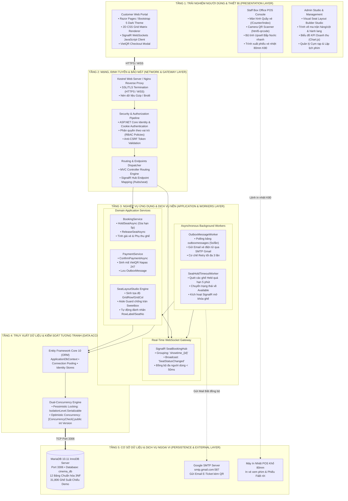
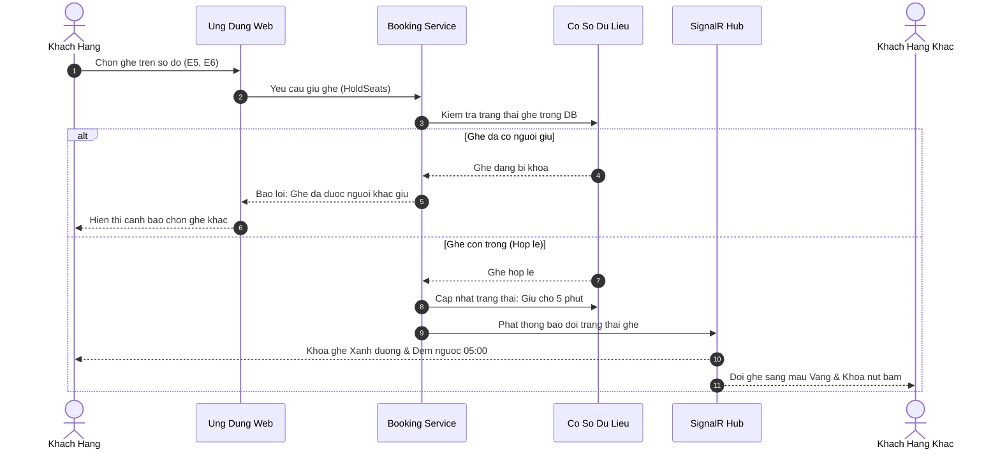
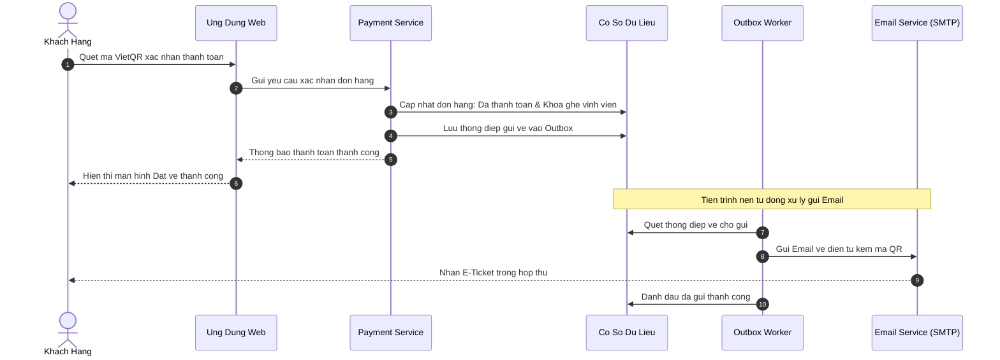
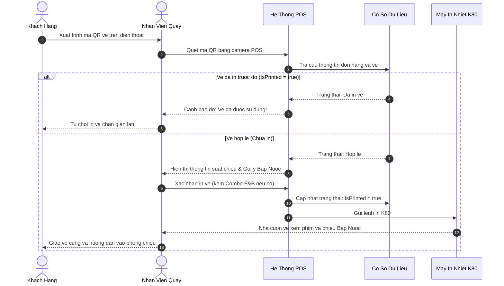
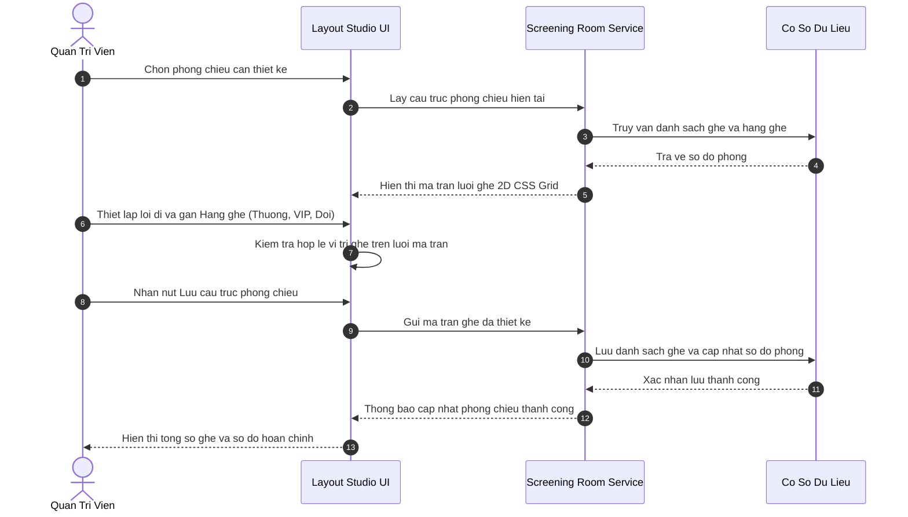

# TÀI LIỆU THIẾT KẾ KIẾN TRÚC HỆ THỐNG (SYSTEM ARCHITECTURE DESIGN)
## HỆ THỐNG QUẢN LÝ CHUỖI RẠP CHIẾU PHIM TẬP TRUNG (CINEMANAGEMENT)

> **Mô hình kiến trúc**: 5-Tier Enterprise Architecture  
> **Giao thức truyền thông**: HTTPS / WebSockets (WSS) / TCP Port 3306 / SMTP Port 587  
> **Cơ chế cốt lõi**: SignalR Multiplexing Hub, Transactional Outbox Pattern, Dual-Concurrency Engine, Visual 2D CSS Grid

---

## 1. TỔNG QUAN KIẾN TRÚC HỆ THỐNG

Kiến trúc hệ thống **CineManagement** được thiết kế nhằm đáp ứng các yêu cầu khắt khe của một chuỗi rạp chiếu phim hiện đại:
1. **Khả năng chịu tải đồng thời cao (High-Concurrency)**: Hàng trăm người dùng cùng truy cập chọn ghế một suất chiếu bom tấn mà không xảy ra hiện tượng tranh chấp (Race Condition) hay bán trùng ghế (Double Booking).
2. **Đồng bộ thời gian thực siêu tốc (< 50ms)**: Bất kỳ thay đổi trạng thái ghế nào lập tức được phát sóng đến tất cả các client đang xem cùng suất chiếu qua WebSockets nhị phân.
3. **Độ tin cậy giao dịch tuyệt đối (Zero Message Loss)**: Đảm bảo 100% email vé điện tử E-Ticket kèm mã QR cá nhân hóa được chuyển phát tin cậy ngay cả khi máy chủ thư điện tử gặp sự cố mạng tạm thời.
4. **Vận hành quầy vé POS "Một Cửa"**: Tích hợp quét mã QR, gợi ý bán kèm bắp nước (Upsell F&B), kiểm tra cờ chống in vé lậu (`IsPrinted Guard`) và xuất lệnh in vé nhiệt K80 80mm.

---

## 2. MÔ HÌNH KIẾN TRÚC PHÂN TẦNG 5 LỚP (5-TIER ENTERPRISE ARCHITECTURE)

```
┌────────────────────────────────────────────────────────────────────────────────────────┐
│ TẦNG 1: TRẢI NGHIỆM NGƯỜI DÙNG & THIẾT BỊ (PRESENTATION LAYER)                          │
│ • Customer Web Portal: Razor Pages, 2D CSS Grid Matrix, SignalR JavaScript Client      │
│ • Staff Box Office POS: html5-qrcode Scanner, Quick Upsell Calculator, 80mm Thermal    │
│ • Admin Studio: Visual Seat Layout Builder, Chart.js KPI Dashboard, Cinema Manager     │
├────────────────────────────────────────────────────────────────────────────────────────┤
│ TẦNG 2: MẠNG, ĐỊNH TUYẾN & BẢO MẬT (NETWORK, ROUTING & GATEWAY LAYER)                 │
│ • Kestrel Application Server (HTTPS / WSS / Reverse Proxy)                             │
│ • ASP.NET Core Middleware Pipeline: Cookie Auth, RBAC Authorization Policy, Anti-CSRF  │
│ • SignalR WebSocket Gateway: Hub Endpoint /hubs/seat, Multiplexing Groups              │
├────────────────────────────────────────────────────────────────────────────────────────┤
│ TẦNG 3: NGHIỆP VỤ ỨNG DỤNG & DỊCH VỤ NỀN (APPLICATION & ASYNC WORKERS LAYER)           │
│ • Controllers: BookingController, CounterController, ScreeningRoomController, etc.    │
│ • Domain Services: BookingService, PaymentService, EmailService, QrCodeService         │
│ • Background Workers: SeatHoldTimeoutWorker (5m sweep), OutboxMessageWorker (5s retry) │
├────────────────────────────────────────────────────────────────────────────────────────┤
│ TẦNG 4: TRUY XUẤT DỮ LIỆU & KIỂM SOÁT TƯƠNG TRANH (DATA ACCESS & CONCURRENCY)          │
│ • Entity Framework Core 10 (Pomelo MySQL / MariaDB Provider)                           │
│ • Dual-Concurrency Engine: [ConcurrencyCheck] Version Token + Serializable Isolation   │
│ • ASP.NET Core Identity Data Stores (Users, Roles, UserClaims)                         │
├────────────────────────────────────────────────────────────────────────────────────────┤
│ TẦNG 5: LƯU TRỮ CƠ SỞ DỮ LIỆU & DỊCH VỤ NGOẠI VI (PERSISTENCE & EXTERNAL LAYER)        │
│ • MariaDB 10.11 InnoDB Server (cinema_db, 12 Relational Tables in 3NF, Port 3306)       │
│ • Google SMTP Server (smtp.gmail.com:587 TLS/SSL)                                      │
│ • Hardware Thermal Receipt Printer (Khổ 80mm ESC/POS / System Print Driver)            │
└────────────────────────────────────────────────────────────────────────────────────────┘
```

---

## 3. SƠ ĐỒ KIẾN TRÚC TỔNG THỂ MERMAID



---

## 4. BIỂU ĐỒ TRÌNH TỰ CÁC LUỒNG NGHIỆP VỤ TRỌNG TÂM (SEQUENCE DIAGRAMS)

### 4.1. Luồng 1: Đặt vé & Giữ ghế Real-Time (SignalR & Concurrency)

Quy trình giữ ghế tạm thời trong 5 phút, đồng bộ trạng thái ghế thời gian thực giữa các người dùng và ngăn chặn xung đột trùng ghế:



---

### 4.2. Luồng 2: Xác nhận Thanh toán & Gửi vé E-Ticket (Checkout & Outbox)

Quy trình xác nhận thanh toán nguyên tử, khóa ghế vĩnh viễn và tiến trình nền Outbox Worker chuyển phát email vé kèm mã QR cho khách hàng:



---

### 4.3. Luồng 3: Quầy vé Box Office: Soát vé QR & Bán vé In nhiệt K80

Quy trình phục vụ tại quầy gồm soát vé QR (kiểm tra cờ chống gian lận `IsPrinted`), gợi ý bán kèm bắp nước (Upsell F&B) và in cuộn vé nhiệt 80mm:



---

### 4.4. Luồng 4: Thiết kế Sơ đồ Phòng chiếu (Visual Layout Builder)

Quy trình Quản trị viên cấu hình ma trận ghế 2D, thiết lập hành lang lối đi, phân loại hạng ghế (Thường, VIP, Đôi) và lưu trữ xuống CSDL:


