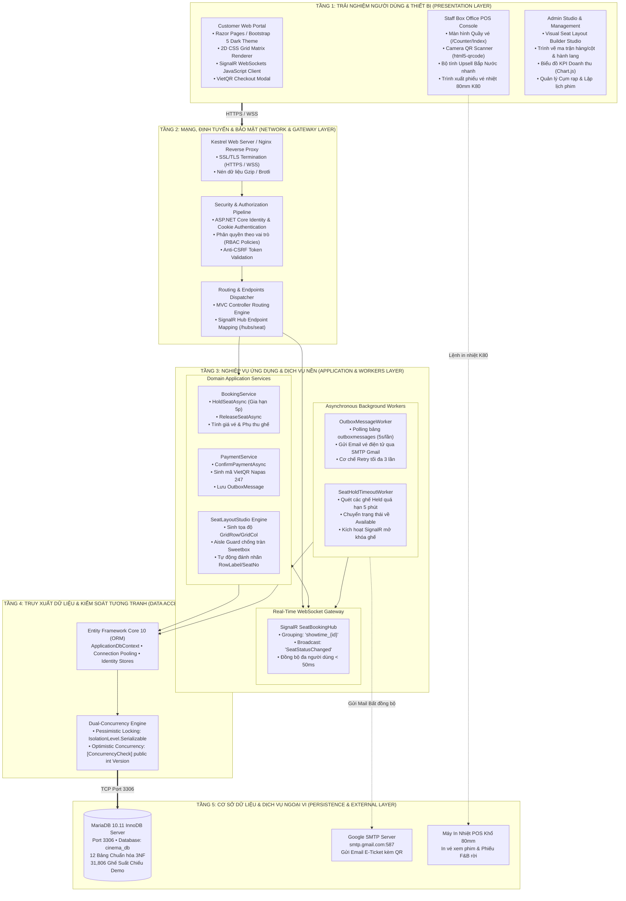
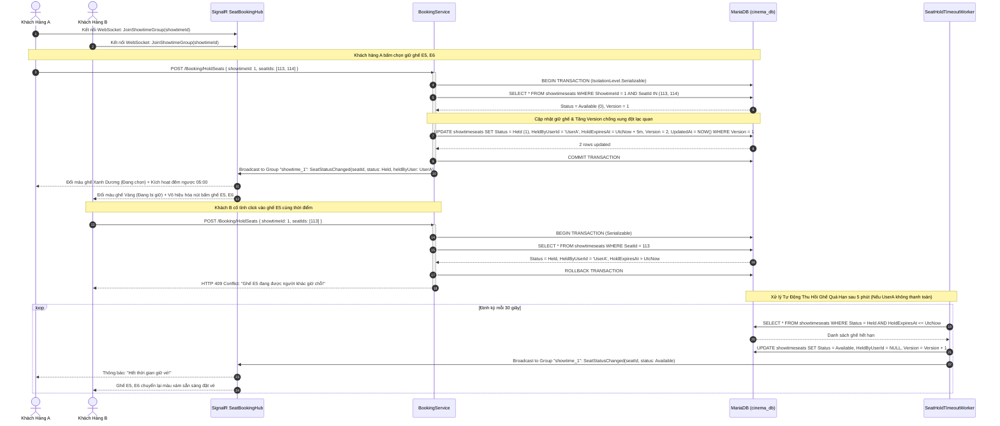
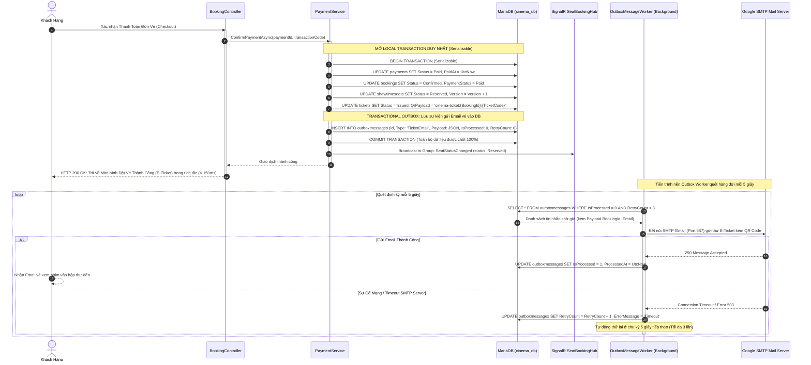
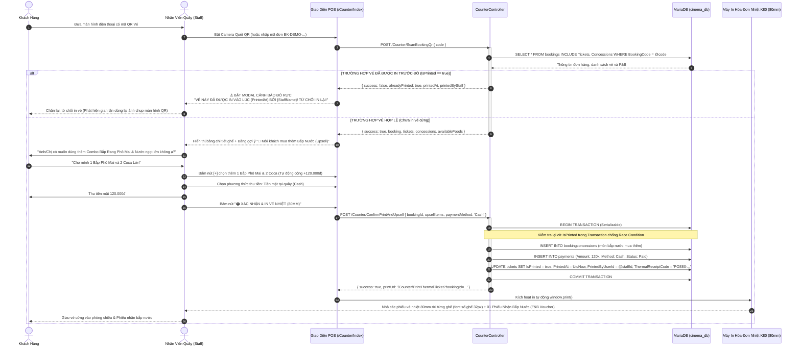

# TÀI LIỆU THIẾT KẾ KIẾN TRÚC HỆ THỐNG (SYSTEM ARCHITECTURE DESIGN)
## HỆ THỐNG QUẢN LÝ CHUỖI RẠP CHIẾU PHIM TẬP TRUNG (CINEMANAGEMENT)

> **Mô hình kiến trúc**: 5-Tier Enterprise Architecture  
> **Giao thức truyền thông**: HTTPS / WebSockets (WSS) / TCP Port 3306 / SMTP Port 587  
> **Cơ chế cốt lõi**: SignalR Multiplexing Hub, Transactional Outbox Pattern, Dual-Concurrency Engine, Visual 2D CSS Grid

---

## 1. TỔNG QUAN KIẾN TRÚC HỆ THỐNG

Kiến trúc hệ thống **CineManagement** được thiết kế nhằm đáp ứng các yêu cầu khắt khe của một chuỗi rạp chiếu phim hiện đại:
1. **Khả năng chịu tải đồng thời cao (High-Concurrency)**: Hàng trăm người dùng cùng truy cập chọn ghế một suất chiếu bom tấn mà không xảy ra hiện tượng tranh chấp (Race Condition) hay bán trùng ghế (Double Booking).
2. **Đồng bộ thời gian thực siêu tốc (< 50ms)**: Bất kỳ thay đổi trạng thái ghế nào lập tức được phát sóng đến tất cả các client đang xem cùng suất chiếu qua WebSockets nhị phân.
3. **Độ tin cậy giao dịch tuyệt đối (Zero Message Loss)**: Đảm bảo 100% email vé điện tử được gửi thành công đến khách hàng qua Transactional Outbox Pattern, độc lập với sự cố mạng máy chủ thư điện tử.
4. **Vận hành quầy vé POS "Một Cửa"**: Tích hợp quét mã QR, gợi ý bán kèm bắp nước (Upsell F&B), kiểm tra cờ chống in vé lậu (`IsPrinted Guard`) và xuất lệnh in vé nhiệt K80 80mm.

---

## 2. MÔ HÌNH KIẾN TRÚC PHÂN TẦNG 5 LỚP (5-TIER ENTERPRISE ARCHITECTURE)

```
┌────────────────────────────────────────────────────────────────────────────────────────┐
│ TẦNG 1: TRẢI NGHIỆM NGƯỜI DÙNG & THIẾT BỊ (PRESENTATION LAYER)                          │
│ • Customer Web Portal: Razor Pages, 2D CSS Grid Matrix, SignalR JavaScript Client      │
│ • Staff Box Office POS: html5-qrcode Scanner, Quick Upsell Calculator, 80mm Thermal    │
│ • Admin Studio: Visual Seat Layout Builder, Chart.js KPI Dashboard, Cinema Manager     │
├────────────────────────────────────────────────────────────────────────────────────────┤
│ TẦNG 2: MẠNG, ĐỊNH TUYẾN & BẢO MẬT (NETWORK, ROUTING & GATEWAY LAYER)                 │
│ • Kestrel Application Server (HTTPS / WSS / Reverse Proxy)                             │
│ • ASP.NET Core Middleware Pipeline: Cookie Auth, RBAC Authorization Policy, Anti-CSRF  │
│ • SignalR WebSocket Gateway: Hub Endpoint /hubs/seat, Multiplexing Groups              │
├────────────────────────────────────────────────────────────────────────────────────────┤
│ TẦNG 3: NGHIỆP VỤ ỨNG DỤNG & DỊCH VỤ NỀN (APPLICATION & ASYNC WORKERS LAYER)           │
│ • Controllers: BookingController, CounterController, ScreeningRoomController, etc.    │
│ • Domain Services: BookingService, PaymentService, EmailService, QrCodeService         │
│ • Background Workers: SeatHoldTimeoutWorker (5m sweep), OutboxMessageWorker (5s retry) │
├────────────────────────────────────────────────────────────────────────────────────────┤
│ TẦNG 4: TRUY XUẤT DỮ LIỆU & KIỂM SOÁT TƯƠNG TRANH (DATA ACCESS & CONCURRENCY)          │
│ • Entity Framework Core 10 (Pomelo MySQL / MariaDB Provider)                           │
│ • Dual-Concurrency Engine: [ConcurrencyCheck] Version Token + Serializable Isolation   │
│ • ASP.NET Core Identity Data Stores (Users, Roles, UserClaims)                         │
├────────────────────────────────────────────────────────────────────────────────────────┤
│ TẦNG 5: LƯU TRỮ CƠ SỞ DỮ LIỆU & DỊCH VỤ NGOẠI VI (PERSISTENCE & EXTERNAL LAYER)        │
│ • MariaDB 10.11 InnoDB Server (cinema_db, 12 Relational Tables in 3NF, Port 3306)       │
│ • Google SMTP Server (smtp.gmail.com:587 TLS/SSL)                                      │
│ • Hardware Thermal Receipt Printer (Khổ 80mm ESC/POS / System Print Driver)            │
└────────────────────────────────────────────────────────────────────────────────────────┘
```

---

## 3. SƠ ĐỒ KIẾN TRÚC TỔNG THỂ MERMAID



---

## 4. BIỂU ĐỒ TRÌNH TỰ CÁC LUỒNG NGHIỆP VỤ TRỌNG TÂM (SEQUENCE DIAGRAMS)

### 4.1. Luồng 1: Đặt vé & Giữ ghế Real-Time với SignalR & Dual-Concurrency



---

### 4.2. Luồng 2: Thanh toán Thành công & Transactional Outbox Pattern



---

### 4.3. Luồng 3: Quầy Vé Box Office POS: Quét QR + Upsell F&B + In Vé Nhiệt 80mm



---

### 4.4. Luồng 4: Trình Thiết Kế Sơ Đồ Phòng Chiếu (Visual Seat Layout Builder Studio)

```mermaid
sequenceDiagram
    autonumber
    actor Admin as Quản Trị Viên (Admin)
    participant StudioUI as Layout Studio (/ScreeningRoom/LayoutBuilder)
    participant RoomCtrl as ScreeningRoomController
    participant Engine as SeatLayoutStudio Engine
    participant DB as MariaDB (cinema_db)

    Admin->>StudioUI: Truy cập Studio thiết kế phòng chiếu RoomId = 1
    StudioUI->>RoomCtrl: GET /ScreeningRoom/LayoutBuilder?id=1
    RoomCtrl->>DB: SELECT * FROM screeningrooms WHERE RoomId = 1; SELECT * FROM seats; SELECT * FROM seattypes;
    DB-->>RoomCtrl: Dữ liệu cấu trúc lưới và danh mục hạng ghế
    RoomCtrl-->>StudioUI: Render giao diện ma trận 2D CSS Grid (TotalRows x TotalCols)

    Note over Admin, StudioUI: Thao tác 1: Bật / Tắt Hành lang Lối đi (Aisle Configurator)
    Admin->>StudioUI: Nhấp vào nút "🚶 Đặt Hành lang Dọc" ở tiêu đề Cột 4 và Cột 13
    StudioUI->>StudioUI: Đánh dấu Cột 4 & 13 là lối đi trống, tự động xóa các ghế ở cột này

    Note over Admin, StudioUI: Thao tác 2: Dùng cọ vẽ Hạng Ghế (Seat Type Painter)
    Admin->>StudioUI: Chọn cọ "💕 Ghế Đôi Sweetbox (ColSpan = 2)"
    Admin->>StudioUI: Nhấp vào ô (Hàng 10, Cột 3) - nằm sát trước hành lang Cột 4
    StudioUI->>Engine: ValidateCoupleSeatPlacement(row: 10, col: 3)
    activate Engine
    Note over Engine: Kiểm tra: Cột tiếp theo là Cột 4 (Cột Hành lang) -> Không hợp lệ!
    Engine-->>StudioUI: { valid: false, error: "Ghế đôi chiếm 2 ô không được lấn vào cột hành lang!" }
    deactivate Engine
    StudioUI-->>Admin: Hiển thị tooltip cảnh báo & Chặn không cho gán ghế đôi tại vị trí này

    Admin->>StudioUI: Nhấp vào ô hợp lệ (Hàng 10, Cột 5)
    StudioUI->>Engine: ValidateCoupleSeatPlacement(row: 10, col: 5)
    activate Engine
    Note over Engine: Cột 5 và Cột 6 đều thuộc Block trung tâm -> Hợp lệ!
    Engine-->>StudioUI: { valid: true }
    deactivate Engine
    StudioUI->>StudioUI: Gán ghế đôi J2 tại Cột 5 với ColSpan = 2 (chiếm Cột 5 và 6)

    Note over Admin, StudioUI: Thao tác 3: Click lại để xóa ghế
    Admin->>StudioUI: Nhấp vào một ghế đã có sẵn một lần nữa
    StudioUI->>StudioUI: Ghế chuyển thành ô trống (Xóa ghế)

    Note over Admin, StudioUI: Thao tác 4: Lưu Sơ đồ Phòng chiếu xuống Database
    Admin->>StudioUI: Bấm "💾 LƯU CẤU TRÚC PHÒNG CHIẾU"
    StudioUI->>Engine: RecalculateLabelsAndSeatNumbers(matrix)
    activate Engine
    Note over Engine: Bỏ qua hàng hành lang để đánh nhãn RowLabel (A, B, C...)<br/>Đánh số ghế SeatNumber từ trái qua phải bỏ qua lối đi
    Engine-->>StudioUI: Danh sách ghế SeatDto[] đã chuẩn hóa
    deactivate Engine

    StudioUI->>RoomCtrl: POST /ScreeningRoom/SaveSeatLayout { roomId, totalRows, totalCols, seats[] }
    activate RoomCtrl
    RoomCtrl->>DB: BEGIN TRANSACTION (Serializable)
    RoomCtrl->>DB: DELETE FROM seats WHERE RoomId = @roomId AND SeatId NOT IN (đã có vé)
    RoomCtrl->>DB: INSERT INTO seats (GridRow, GridCol, RowLabel, SeatNumber, ColSpan, SeatTypeId)
    RoomCtrl->>DB: Đồng bộ an toàn bảng showtimeseats cho các suất chiếu tương lai
    RoomCtrl->>DB: COMMIT TRANSACTION
    RoomCtrl-->>StudioUI: { success: true, message: "Đã lưu sơ đồ phòng chiếu thành công!" }
    deactivate RoomCtrl
    StudioUI-->>Admin: Hiển thị thông báo thành công & Cập nhật số ghế thực tế
```
