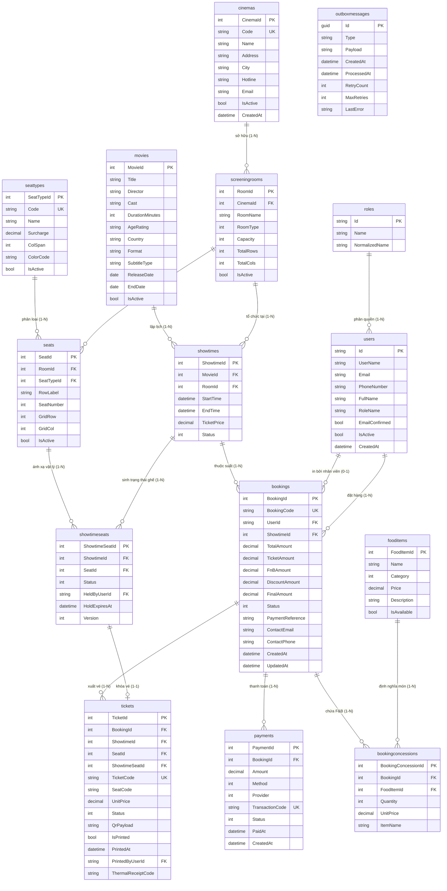

# TÀI LIỆU THIẾT KẾ CƠ SỞ DỮ LIỆU & SƠ ĐỒ THỰC THỂ (3NF ERD)
## HỆ THỐNG QUẢN LÝ CHUỖI RẠP CHIẾU PHIM TẬP TRUNG (CINEMANAGEMENT)

> **Hệ quản trị CSDL**: MariaDB 10.11 / MySQL 8.0 (Storage Engine: InnoDB, Charset: utf8mb4)  
> **Tên Database**: `cinema_db` (Port: 3306)  
> **Tiêu chuẩn chuẩn hóa**: Chuẩn hóa Dạng chuẩn 3 (Third Normal Form - 3NF)  
> **Chiến lược tương tranh**: Khóa phiên bản [ConcurrencyCheck] Version Token + IsolationLevel.Serializable

---

## 1. CHIẾN LƯỢC THIẾT KẾ CSDL CHUẨN HÓA 3NF

Cơ sở dữ liệu của **CineManagement** được thiết kế đáp ứng các nguyên tắc chuẩn hóa 3NF nghiêm ngặt nhằm tránh dư thừa dữ liệu và tối ưu hiệu năng:
1. **Tách biệt Trạng thái Ghế Vật lý và Trạng thái Suất chiếu**:
   * Bảng `seats`: Đại diện cho vị trí phần cứng cố định của phòng chiếu (`GridRow`, `GridCol`, `SeatTypeId`, `IsActive`).
   * Bảng `showtimeseats`: Đại diện cho trạng thái động biến thiên theo từng suất chiếu cụ thể (`Status`: Available, Held, Reserved; `HeldByUserId`, `HoldExpiresAt`, `Version`). Một ghế vật lý có thể tham gia hàng ngàn suất chiếu khác nhau mà không bao giờ gây xung đột dữ liệu.
2. **Snapshot Đơn Giá và Thông Tin Vé**:
   * Bảng `tickets` và `bookingconcessions` lưu trữ snapshot đơn giá (`Price`, `UnitPrice`) tại thời điểm khách hàng thanh toán thành công. Khi quản trị viên thay đổi giá vé hoặc giá bắp nước trong tương lai, lịch sử doanh thu quá khứ không bao giờ bị sai lệch.
3. **Mở rộng Chuỗi Cụm Rạp (Multiplex Cinema Chain)**:
   * Bảng `cinemas` liên kết 1-N với `screeningrooms`, cho phép quản lý chuỗi hàng chục cụm rạp trên toàn quốc (`CS-QT`, `CS-HBT`, `CS-BD`).
4. **Đảm bảo Tính Toàn Vẹn với Transactional Outbox Pattern**:
   * Bảng `outboxmessages` lưu vết các thông điệp sự kiện (`TicketEmail`) trong cùng một Local Transaction với đơn hàng, bảo đảm tính nguyên tử $ACID$.

---

## 2. SƠ ĐỒ QUAN HỆ THỰC THỂ TỔNG THỂ (MERMAID ERD 15 BẢNG CHUẨN 3NF)



---

## 3. TỪ ĐIỂN DỮ LIỆU CHI TIẾT (DATA DICTIONARY)

### 3.1. Bảng `cinemas` (Cụm rạp chi nhánh)
| Tên Cột | Kiểu Dữ Liệu | Ràng Buộc | Mô Tả |
| :--- | :--- | :---: | :--- |
| `CinemaId` | `INT` | PK, Auto Increment | Định danh duy nhất cụm rạp |
| `Code` | `VARCHAR(30)` | UNIQUE, NOT NULL | Mã định danh rạp (`CS-QT`, `CS-HBT`, `CS-BD`) |
| `Name` | `VARCHAR(150)` | NOT NULL | Tên thương mại cụm rạp |
| `Address` | `VARCHAR(300)` | NOT NULL | Địa chỉ chi tiết rạp chiếu |
| `City` | `VARCHAR(100)` | NOT NULL | Tỉnh / Thành phố trực thuộc |
| `Hotline` | `VARCHAR(30)` | NULL | Số điện thoại đường dây nóng |
| `Email` | `VARCHAR(150)` | NULL | Email liên hệ hỗ trợ |
| `IsActive` | `TINYINT(1)` | NOT NULL, DEFAULT 1 | Trạng thái rạp đang mở cửa |

### 3.2. Bảng `screeningrooms` (Phòng chiếu phim)
| Tên Cột | Kiểu Dữ Liệu | Ràng Buộc | Mô Tả |
| :--- | :--- | :---: | :--- |
| `RoomId` | `INT` | PK, Auto Increment | Định danh duy nhất phòng chiếu |
| `CinemaId` | `INT` | FK -> cinemas(CinemaId) | Thuộc cụm rạp nào |
| `RoomName` | `VARCHAR(100)` | NOT NULL | Tên phòng (`Phòng 1 - Standard`, `IMAX Laser`) |
| `TotalRows` | `INT` | NOT NULL | Số hàng trên lưới ma trận phòng |
| `TotalCols` | `INT` | NOT NULL | Số cột trên lưới ma trận phòng |
| `Capacity` | `INT` | NOT NULL | Tổng sức chứa ghế thực tế của phòng |
| `RoomType` | `INT` | NOT NULL | Phân loại định dạng phòng (0: 2D, 1: 3D, 2: IMAX) |

### 3.3. Bảng `seattypes` (Danh mục Hạng ghế)
| Tên Cột | Kiểu Dữ Liệu | Ràng Buộc | Mô Tả |
| :--- | :--- | :---: | :--- |
| `SeatTypeId` | `INT` | PK, Auto Increment | Định danh duy nhất hạng ghế |
| `Code` | `VARCHAR(20)` | UNIQUE, NOT NULL | Mã code (`STANDARD`, `VIP`, `COUPLE`) |
| `Name` | `VARCHAR(50)` | NOT NULL | Tên hiển thị (`Ghế Thường`, `Ghế VIP`, `Ghế Đôi`) |
| `Surcharge` | `DECIMAL(15,0)` | NOT NULL, DEFAULT 0 | Mức phụ thu cộng thêm vào vé gốc (VNĐ) |
| `ColSpan` | `INT` | NOT NULL, DEFAULT 1 | Độ rộng chiếm ô lưới (1: Đơn, 2: Ghế Đôi) |
| `ColorCode` | `VARCHAR(10)` | NOT NULL | Mã màu HEX hiển thị trên sơ đồ (`#ffc107`, `#e83e8c`) |

### 3.4. Bảng `seats` (Ghế vật lý phòng chiếu)
| Tên Cột | Kiểu Dữ Liệu | Ràng Buộc | Mô Tả |
| :--- | :--- | :---: | :--- |
| `SeatId` | `INT` | PK, Auto Increment | Định danh duy nhất ghế vật lý |
| `RoomId` | `INT` | FK -> screeningrooms(RoomId) | Thuộc phòng chiếu nào |
| `SeatTypeId` | `INT` | FK -> seattypes(SeatTypeId) | Hạng ghế tương ứng |
| `GridRow` | `INT` | NOT NULL | Tọa độ hàng trên lưới 2D ($1 \le \text{GridRow} \le \text{TotalRows}$) |
| `GridCol` | `INT` | NOT NULL | Tọa độ cột trên lưới 2D ($1 \le \text{GridCol} \le \text{TotalCols}$) |
| `RowLabel` | `VARCHAR(5)` | NOT NULL | Nhãn hàng hiển thị (`A`, `B`, `C`...) |
| `SeatNumber` | `INT` | NOT NULL | Số thứ tự ghế trong hàng (`1`, `2`...) |
| `IsActive` | `TINYINT(1)` | NOT NULL, DEFAULT 1 | Khả dụng hay đang khóa bảo trì |

### 3.5. Bảng `showtimes` (Lịch suất chiếu)
| Tên Cột | Kiểu Dữ Liệu | Ràng Buộc | Mô Tả |
| :--- | :--- | :---: | :--- |
| `ShowtimeId` | `INT` | PK, Auto Increment | Định danh duy nhất suất chiếu |
| `MovieId` | `INT` | FK -> movies(MovieId) | Chiếu bộ phim nào |
| `RoomId` | `INT` | FK -> screeningrooms(RoomId) | Chiếu tại phòng nào |
| `StartTime` | `DATETIME(6)` | NOT NULL | Thời điểm bắt đầu chiếu |
| `EndTime` | `DATETIME(6)` | NULL | Thời điểm kết thúc chiếu |
| `TicketPrice` | `DECIMAL(15,0)` | NOT NULL | Đơn giá vé cơ bản của suất chiếu (VNĐ) |
| `Status` | `INT` | NOT NULL | Trạng thái (0: Sắp chiếu, 1: Đang chiếu, 2: Hủy) |

### 3.6. Bảng `showtimeseats` (Trạng thái ghế theo suất chiếu)
| Tên Cột | Kiểu Dữ Liệu | Ràng Buộc | Mô Tả |
| :--- | :--- | :---: | :--- |
| `ShowtimeSeatId`| `INT` | PK, Auto Increment | Định danh duy nhất trạng thái ghế |
| `ShowtimeId` | `INT` | FK -> showtimes(ShowtimeId) | Thuộc suất chiếu nào |
| `SeatId` | `INT` | FK -> seats(SeatId) | Ghế vật lý tương ứng |
| `SeatTypeId` | `INT` | FK -> seattypes(SeatTypeId) | Snapshot hạng ghế |
| `Price` | `DECIMAL(15,0)` | NOT NULL | Giá vé thực tế tính theo hạng ghế |
| `Status` | `INT` | NOT NULL, DEFAULT 0 | 0: Available, 1: Held, 2: Reserved |
| `HeldByUserId` | `VARCHAR(450)` | NULL | Mã User/Session đang giữ ghế |
| `HoldExpiresAt` | `DATETIME(6)` | NULL | Thời điểm hết hạn giữ ghế (UtcNow + 5m) |
| `Version` | `INT` | NOT NULL, DEFAULT 1 | **Khóa kiểm tra xung đột tương tranh lạc quan** |

### 3.7. Bảng `tickets` (Vé điện tử & Vé in nhiệt)
| Tên Cột | Kiểu Dữ Liệu | Ràng Buộc | Mô Tả |
| :--- | :--- | :---: | :--- |
| `TicketId` | `INT` | PK, Auto Increment | Định danh duy nhất vé |
| `BookingId` | `INT` | FK -> bookings(BookingId) | Thuộc đơn hàng nào |
| `SeatId` | `INT` | FK -> seats(SeatId) | Vị trí ghế xem phim |
| `TicketCode` | `VARCHAR(50)` | UNIQUE, NOT NULL | Mã vé duy nhất (`TK-...`) |
| `QrPayload` | `VARCHAR(500)` | NOT NULL | Chuỗi mã hóa QR (`cinema-ticket:12:TK-...`) |
| `IsPrinted` | `TINYINT(1)` | NOT NULL, DEFAULT 0 | **Cờ kiểm định vé đã in ra giấy nhiệt tại quầy** |
| `PrintedAt` | `DATETIME(6)` | NULL | Thời điểm in vé nhiệt tại quầy |
| `PrintedByUserId`| `VARCHAR(450)` | NULL | Định danh nhân viên thực hiện in vé |
| `ThermalReceiptCode`| `VARCHAR(50)` | NULL | Mã phiếu in nhiệt (`POS80-...`) |

### 3.8. Bảng `outboxmessages` (Transactional Outbox Events)
| Tên Cột | Kiểu Dữ Liệu | Ràng Buộc | Mô Tả |
| :--- | :--- | :---: | :--- |
| `Id` | `CHAR(36)` | PK (GUID) | Định danh duy nhất thông điệp sự kiện |
| `Type` | `VARCHAR(100)` | NOT NULL | Loại sự kiện (`TicketEmail`, `SeatReleased`) |
| `Payload` | `LONGTEXT` | NOT NULL | Nội dung chi tiết sự kiện dạng JSON |
| `IsProcessed` | `TINYINT(1)` | NOT NULL, DEFAULT 0 | Cờ trạng thái đã gửi thành công |
| `CreatedAt` | `DATETIME(6)` | NOT NULL | Thời điểm tạo thông điệp sự kiện |
| `ProcessedAt` | `DATETIME(6)` | NULL | Thời điểm gửi email thành công |
| `RetryCount` | `INT` | NOT NULL, DEFAULT 0 | Số lần đã thử lại khi gặp sự cố mạng |
| `ErrorMessage` | `VARCHAR(1000)`| NULL | Nhật ký lỗi nếu quá trình gửi thất bại |

---

## 4. CHIẾN LƯỢC COMPOSITE INDEXING TỐI ƯU HIỆU NĂNG

Để đảm bảo hiệu năng tra cứu $< 20\text{ ms}$ trong các khung giờ cao điểm với hơn $31,800$ bản ghi `showtimeseats`, hệ thống thiết lập các chỉ mục phức hợp chuyên sâu:

```sql
-- 1. Tối ưu tra cứu trạng thái ghế theo suất chiếu (SignalR & Seat Map)
CREATE INDEX IX_ShowtimeSeats_Showtime_Status ON showtimeseats (ShowtimeId, Status);

-- 2. Tối ưu tác vụ quét ghế quá hạn của Background Worker
CREATE INDEX IX_ShowtimeSeats_Held_Timeout ON showtimeseats (Status, HoldExpiresAt);

-- 3. Tối ưu tác vụ quét hàng đợi Transactional Outbox (Outbox Worker)
CREATE INDEX IX_OutboxMessages_Processed_Retry ON outboxmessages (IsProcessed, RetryCount);

-- 4. Tối ưu quét mã QR và kiểm tra cờ chống in lậu vé tại quầy POS
CREATE INDEX IX_Tickets_Booking_IsPrinted ON tickets (BookingId, IsPrinted);
```
