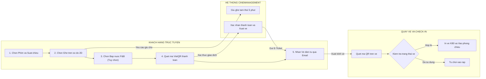
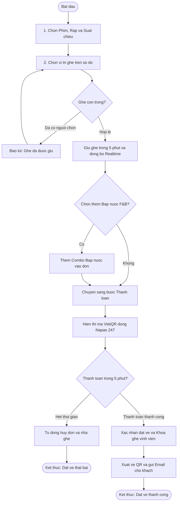
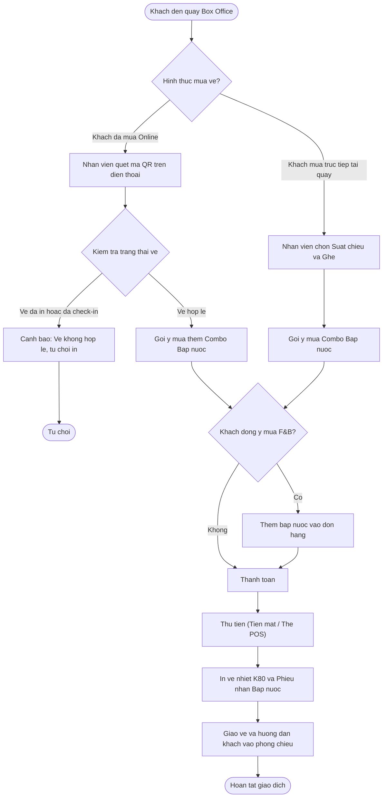

# TÀI LIỆU QUY TRÌNH NGHIỆP VỤ HỆ THỐNG (SYSTEM WORKFLOWS)
## HỆ THỐNG QUẢN LÝ CHUỖI RẠP CHIẾU PHIM TẬP TRUNG (CINEMANAGEMENT)

> Đối tượng sử dụng: Khách hàng (Customer Online) và Nhân viên quầy (Staff POS)  
> Mục tiêu thiết kế: Tối ưu trải nghiệm đặt vé, loại bỏ trùng ghế thời gian thực, quản lý bán vé và soát vé quầy chặt chẽ, chống gian lận.

---

## 1. SƠ ĐỒ WORKFLOW TỔNG THỂ HỆ THỐNG

Sơ đồ tổng quan biểu diễn dòng chảy nghiệp vụ xuyên suốt từ khi khách hàng tìm kiếm suất chiếu trên website/ứng dụng cho đến khi nhận vé và thực hiện check-in tại cụm rạp:

---

## 2. LUỒNG NGHIỆP VỤ 1: ĐẶT VÉ VÀ THANH TOÁN TRỰC TUYẾN (ONLINE BOOKING)

Quy trình khách hàng chọn suất chiếu, chọn vị trí ghế trên sơ đồ 2D trực quan, giữ chỗ tạm thời trong 5 phút và thanh toán tự động qua mã VietQR Napas 247:

### Các bước thực hiện chi tiết:
1. **Lựa chọn thông tin suất chiếu**: Khách hàng tìm kiếm theo cụm rạp, bộ phim và khung giờ chiếu mong muốn.
2. **Chọn vị trí ghế ngồi**: Giao diện hiển thị sơ đồ phòng chiếu 2D trực quan (Ghế thường, Ghế VIP, Ghế đôi). Trạng thái ghế được cập nhật theo thời gian thực (Realtime).
3. **Giữ chỗ tạm thời**: Ghế được hệ thống khóa tạm thời trong 5 phút cho riêng khách hàng, ngăn chặn tình trạng nhiều người cùng bấm một ghế.
4. **Bắp nước (F&B) & Thanh toán**: Khách hàng có thể chọn thêm combo bắp nước hoặc chuyển thẳng đến màn hình thanh toán VietQR.
5. **Xử lý kết quả giao dịch**:
   - Nếu quá 5 phút chưa hoàn tất thanh toán: Hệ thống tự động hủy đơn và trả ghế về trạng thái sẵn sàng để người khác đặt.
   - Nếu thanh toán thành công: Đơn hàng được xác nhận, ghế chuyển sang trạng thái đã bán, mã vé QR và thông tin hóa đơn được gửi đến Email của khách hàng.

---

## 3. LUỒNG NGHIỆP VỤ 2: BÁN VÉ VÀ SOÁT VÉ TẠI QUẦY (BOX OFFICE POS)

Quy trình phục vụ tại quầy vé của rạp bao gồm 2 nghiệp vụ chính: Check-in / in vé cho khách đã đặt Online và Bán vé trực tiếp cho khách vãng lai:

### Các bước thực hiện chi tiết:
1. **Tiếp nhận khách hàng**:
   - **Khách hàng đã đặt Online**: Nhân viên dùng máy quét camera POS quét mã QR trên điện thoại khách hàng. Hệ thống kiểm tra cờ trạng thái (`IsPrinted`). Nếu vé đã in hoặc đã qua cổng trước đó, hệ thống sẽ đưa ra cảnh báo từ chối để chống gian lận.
   - **Khách hàng mua trực tiếp (Walk-in)**: Nhân viên chọn nhanh phim, suất chiếu và vị trí ghế theo yêu cầu của khách trên màn hình cảm ứng POS.
2. **Bán gia tăng dịch vụ (Upsell F&B)**: Màn hình gợi ý các gói combo bắp nước đang có ưu đãi để nhân viên tư vấn nhanh cho khách.
3. **Thanh toán & Xuất vé**: Nhân viên thu tiền mặt hoặc quẹt thẻ POS. Máy in nhiệt K80 in ngay cuộn vé xem phim cùng phiếu nhận bắp nước tách rời.

---

## 4. TỔNG KẾT VÀ ĐẶC ĐIỂM TRỌNG TÂM CỦA 2 LUỒNG NGHIỆP VỤ

| Tiêu chí | Luồng 1: Đặt vé Trực tuyến (Online Booking) | Luồng 2: Quầy vé Box Office (POS & Check-in) |
| :--- | :--- | :--- |
| **Đối tượng thao tác** | Khách hàng thao tác trên Web/Mobile Browser | Nhân viên thu ngân/soát vé thao tác trên máy POS |
| **Giao diện chính** | Sơ đồ ghế 2D, cổng thanh toán VietQR động | Màn hình bán vé nhanh POS, camera quét mã QR vé |
| **Cơ chế kiểm soát** | Giữ chỗ 5 phút, tự động hủy nếu quá hạn | Kiểm tra cờ IsPrinted, chống tái sử dụng vé gian lận |
| **Đầu ra nghiệp vụ** | Mã vé điện tử E-Ticket, QR Code qua Email | Cuộn vé in nhiệt K80 (Vé xem phim + Voucher F&B) |
| **Thời gian xử lý** | Dưới 2 phút / lượt giao dịch | Dưới 15 giây / lượt soát vé hoặc bán vé tại quầy |
