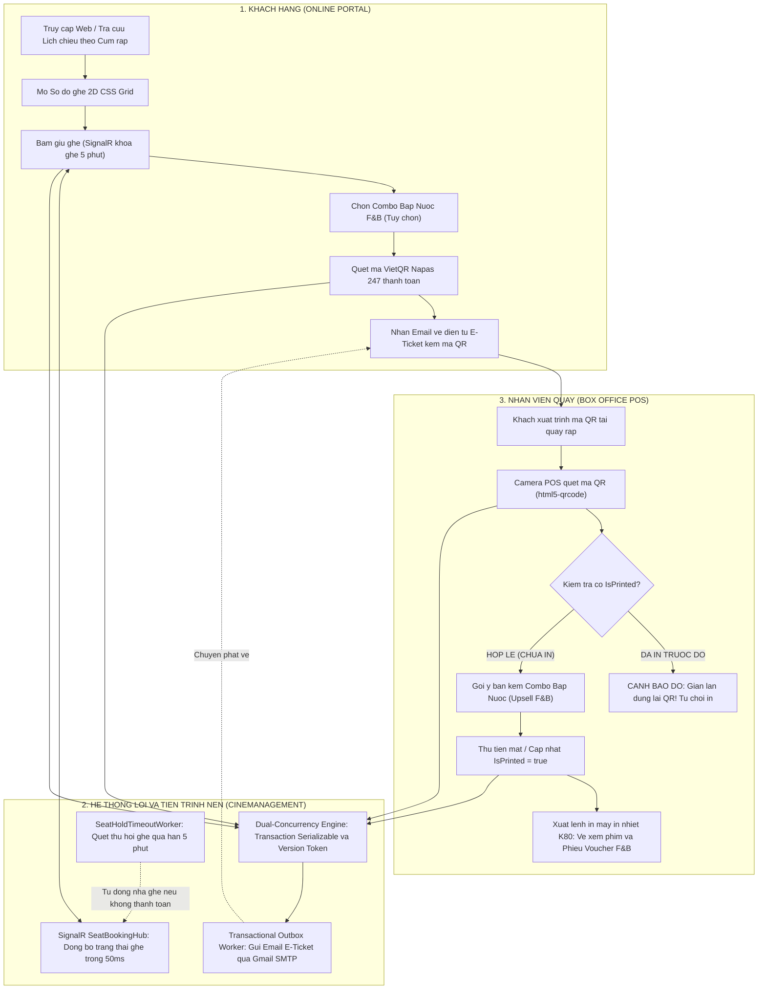
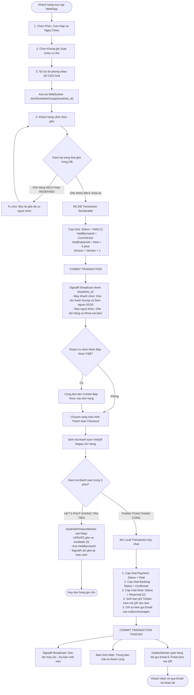
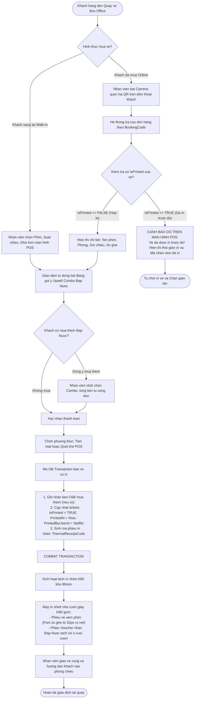

# TÀI LIỆU QUY TRÌNH NGHIỆP VỤ HỆ THỐNG (SYSTEM WORKFLOWS)
## HỆ THỐNG QUẢN LÝ CHUỖI RẠP CHIẾU PHIM TẬP TRUNG (CINEMANAGEMENT)

> Hệ thống kiến trúc: 5-Tier Enterprise Architecture  
> Công nghệ cốt lõi: SignalR WebSocket, Dual-Concurrency Engine, Transactional Outbox Pattern  
> Đối tượng vận hành: Khách hàng (Customer), Nhân viên quầy (Staff POS), Hệ thống dịch vụ nền (Background Services)

---

## 1. SƠ ĐỒ WORKFLOW TỔNG THỂ HỆ THỐNG

Sơ đồ biểu diễn dòng chảy dữ liệu và sự tương tác xuyên suốt giữa Khách hàng trực tuyến, Hệ thống xử lý trung tâm và Nhân viên quầy vé Box Office:

---

## 2. WORKFLOW 1: QUY TRÌNH ĐẶT VÉ VÀ GIỮ GHẾ TRỰC TUYẾN (ONLINE BOOKING)

Quy trình xử lý chọn suất chiếu, ma trận ghế 2D, khóa ghế thời gian thực qua SignalR, thanh toán tức thời và xuất vé nguyên tử:

---

## 3. WORKFLOW 2: QUY TRÌNH VẬN HÀNH QUẦY VÉ POS VÀ SOÁT VÉ IN NHIỆT K80

Quy trình phục vụ khách tại quầy, kiểm tra cờ chống in lậu vé (`IsPrinted Guard`), gợi ý bán kèm bắp nước (Upsell F&B) và xuất cuộn vé nhiệt 80mm:

---

## 4. WORKFLOW 3: QUY TRÌNH TỰ ĐỘNG HÓA NỀN VÀ XỬ LÝ SỰ CỐ (BACKGROUND WORKERS)

Quy trình chạy ngầm bảo đảm tính toàn vẹn hệ thống: Tự động thu hồi ghế quá hạn 5 phút và cơ chế Retry chuyển phát email vé qua Transactional Outbox Pattern:

```mermaid
flowchart TD
    subgraph WORKER_TIMEOUT ["4.1. SEAT HOLD TIMEOUT WORKER (QUET MOI 30 GIAY)"]
        T1([Bo dem 30 giay kich hoat]) --> T2["Quet DB: SELECT FROM showtimeseats WHERE Status = Held AND HoldExpiresAt <= Now"]
        T2 --> T3{"Co ghe bi giu qua han 5 phut?"}
        T3 -- "Khong co" --> T_Sleep["Nghi 30 giay cho chu ky tiep theo"]
        T3 -- "Phat hien ghe qua han" --> T4["Mo Transaction:
        UPDATE showtimeseats
        SET Status = Available (0), HeldByUserId = NULL, Version = Version + 1"]
        T4 --> T5["COMMIT TRANSACTION"]
        T5 --> T6["SignalR phat song nhom showtime_id:
        - Doi mau ghe ve lai mau xam
        - Mo khoa cho nguoi khac dat ngay lap tuc"]
        T6 --> T_Sleep
    end

    subgraph WORKER_OUTBOX ["4.2. TRANSACTIONAL OUTBOX WORKER (QUET MOI 5 GIAY)"]
        O1([Bo dem 5 giay kich hoat]) --> O2["Quet DB: SELECT FROM outboxmessages WHERE IsProcessed = 0 AND RetryCount < 3"]
        O2 --> O3{"Co thong diep ve cho gui?"}
        O3 -- "Hang doi rong" --> O_Sleep["Nghi 5 giay cho chu ky tiep theo"]
        O3 -- "Co thu can gui" --> O4["Giai ma Payload: Lay BookingId, Email khach, Ma ve, QR Code"]
        O4 --> O5["Ket noi Google SMTP Server smtp.gmail.com:587"]
        
        O5 --> Check_SMTP{"Ket noi gui mail thanh cong?"}
        
        Check_SMTP -- "THANH CONG (SMTP 250)" --> O_Success["UPDATE outboxmessages
        SET IsProcessed = 1, ProcessedAt = Now"]
        O_Success --> O_Delivered["Khach nhan duoc E-Ticket trong hop thu"]
        
        Check_SMTP -- "SU CO MANG / TIMEOUT / GMAIL 503" --> O_Fail["UPDATE outboxmessages
        SET RetryCount = RetryCount + 1, ErrorMessage = 'Connection Timeout'"]
        O_Fail --> O_Retry["Ghi nhan loi va Tu dong thu lai o chu ky 5 giay ke tiep"]
        
        O_Success --> O_Sleep
        O_Retry --> O_Sleep
    end
```

---

## 5. BẢNG TỔNG KẾT VÀ CƠ CHẾ ĐẢM BẢO TÍNH TOÀN VẸN

| Quy trình nghiệp vụ | Tác nhân chính | Cơ chế kỹ thuật cốt lõi | Kết quả đảm bảo |
| :--- | :--- | :--- | :--- |
| **Workflow 1: Đặt vé Online** | Khách hàng | IsolationLevel.Serializable, Version Token, SignalR WebSockets | Đặt vé đồng thời không trùng ghế, phản hồi dưới 50ms. |
| **Workflow 2: Quầy POS Box Office** | Nhân viên quầy | Cờ kiểm soát IsPrinted Guard, Camera html5-qrcode, In nhiệt K80 | Soát vé dưới 10 giây, chống in lậu, in vé phim và F&B Voucher. |
| **Workflow 3: Tiến trình nền (Workers)** | Background Services | Transactional Outbox Pattern, Polling định kỳ 30s và 5s | Tự động giải phóng ghế quá hạn, cam kết 100% gửi vé thành công. |
